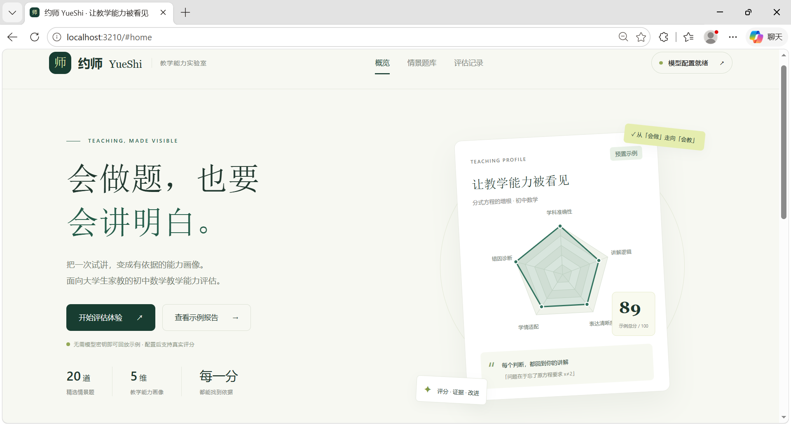
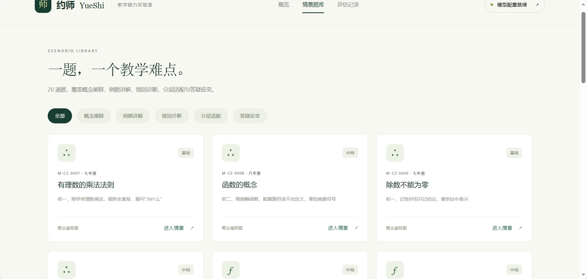
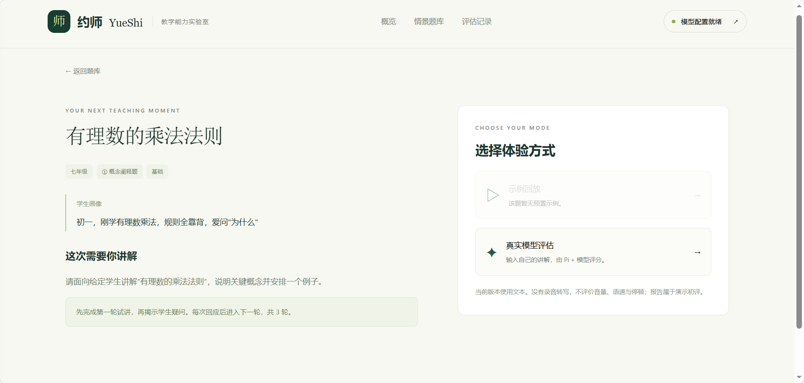
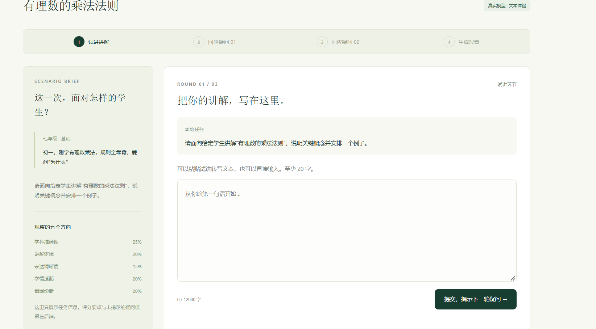
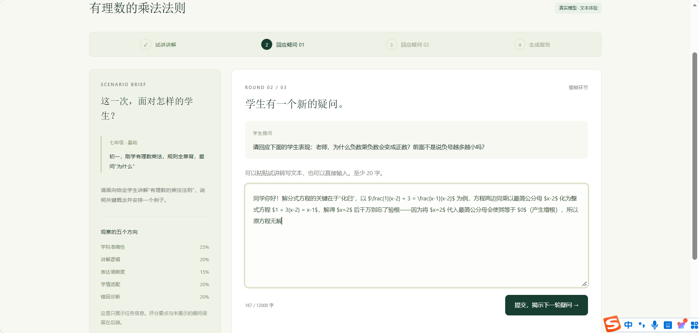

# 本地运行

1. 安装 Node.js 24 LTS，安装时保留 Add to PATH。
2. 下载并解压源码，用 VS Code 打开 yueshi-demo 文件夹。
3. 打开终端，执行 npm ci（首次需要联网下载依赖）。
4. 执行 npm start，浏览器访问 http://localhost:3210。
5. 不配置密钥即可使用预置示例回放。真实评分需要在 .env，填入自己的大模型地址、型号和密钥，再重启服务。（目前接入的是智谱5.3-flash）。
6. Windows 安装依赖后也可双击 START-DEMO.cmd 打开项目界面。macOS/Linux 使用 npm start。

智谱配置示例（.env文件中，目前用的是我自己的密钥，可更改）：  
MODEL_BASE_URL=https://open.bigmodel.cn/api/paas/v4  
MODEL_ID=glm-5.3-flash  
MODEL_API_KEY=7ed5ad7c29e245bc94654306f44abe6d  
PORT=3210

页面示例：
  

  

  

  

