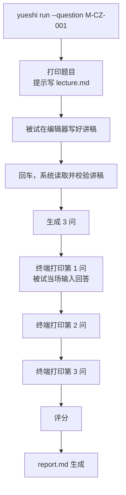

# 教学能力评估智能体 · 原型设计方案

> 版本：v1.0　｜　依据：[problem_definition.md](requirements/problem_definition.md)、[functional_spec.md](requirements/functional_spec.md)
> 形态：**文件驱动的命令行系统**（无前后端平台、无数据库）——输入文本，输出报告。

---

## 1. 产品定位与目标用户

| 项 | 内容 |
|---|---|
| 一句话定位 | 给定一道初中数学讲题，被试交讲稿、答 3 个虚拟学生的提问，系统输出**评级 + 分项得分 + 改进建议** |
| 核心价值 | 把"会不会讲课"变成**可测量、可比较、可复现**的评估；每个扣分都**有理由、有原文证据** |
| 形态 | 本地 Python 命令行程序：**讲稿交文件，问答在终端交互**，输出 Markdown 报告 |
| 目标用户 | ① 被试（大学生家教）：想知道自己讲得怎么样；② 研究者/评审：检验评估方法是否可靠；③ 下游平台：消费评级结果 |
| 非目标 | 不做 Web 平台、不做账号体系、不做人工复核 |

### 典型场景

| 场景 | 输入 | 输出 |
|---|---|---|
| **单次完整评估**（被试） | 讲稿文件 + 终端输入 3 个回答 | 评级 + 分项报告 |
| **中断续跑** | 已保存的 session 目录 | 从断点继续 |
| **批量评测**（研究者） | 一批 JSON 样本（含讲稿与答案） | 批量报告 + 一致性统计 |

---

## 2. 信息架构

### 2.1 目录与文件结构

```text
yueshi/
├── datasets/                       # 静态资产（人工维护）
│   ├── questions/              # 9 个真题，每题一个文件
│   │   ├── M-CZ-001-科学计数法.json
│   │   └── ...
│   ├── personas/               # 5 类虚拟学生人设
│   │   └── personas.json
│   └── examples/               # 评分参照物（优质 / 典型问题）
│       ├── 科学计数法-高质量讲稿.md
│       └── 科学计数法-普通讲稿.md
│
├── workspace/                  # 运行时产物（每次评估一个目录）
│   └── EV-20261105-0001/
│       ├── lecture.md          # 讲稿（被试在编辑器里写）
│       ├── session.json        # 会话状态（含题目、3 问、3 答）
│       └── report.md           # 最终报告（程序直接拼装 Markdown 写出）
```

> **设计要点**：
> - **讲稿走文件**（`lecture.md`）——1000+ 字，在编辑器里写更合适；
> - **问答走命令行**——问题直接打印到终端，被试当场输入回答，一问一答连续进行；
> - 因此**不需要** `q*.md` / `a*.md` 中间文件，问答内容直接存入 `session.json`。

### 2.2 用户流程

一条命令跑完全程，中途在终端完成 3 轮问答：



### 2.3 会话文件（session.json）—— 系统的"单一事实源"

```json
{
  "sessionId": "EV-20261105-0001",
  "candidateId": "candidate-001",
  "questionId": "M-CZ-001",
  "status": "QA_ROUND_2",
  "createdAt": "2026-11-05T14:30:00+08:00",
  "lectureScript": { "path": "lecture.md", "wordCount": 1280 },
  "personaAssignment": ["P1", "P2", "P4"],
  "questions": [
    {
      "round": 1,
      "personaId": "P1",
      "personaName": "概念严谨型",
      "text": "老师，您说 A 比 10 小、比 1 大；但例 5（1）是 1×10⁶，这里的 1 并不比 1 大……",
      "referenceAnswerPoints": ["指出表述应为 1≤A<10", "承认瑕疵并修正", "解释为何 A=1 合规"],
      "revealed": true,
      "validated": true
    },
    { "round": 2, "personaId": "P2", "text": "…", "revealed": false },
    { "round": 3, "personaId": "P4", "text": "…", "revealed": false }
  ],
  "answers": [
    {
      "round": 1,
      "text": "老师，您刚才说的定义确实是 A 比 10 小、比 1 大。但课本例 5 里 1×10⁶ 中的 1 正好等于 1……",
      "wordCount": 210,
      "answeredAt": "2026-11-05T14:45:00+08:00"
    }
  ],
  "config": {
    "rubricVersion": "v1.0",
    "promptVersion": "v1.0",
    "model": "openai-compatible",
    "sampleCount": 3
  }
}
```

**为什么用 JSON 而不是数据库**：

- 一次评估 = 一个目录，**可打包、可归档、可版本化**
- 研究者可以直接 git 管理、批量脚本处理
- 无并发需求，无需事务

---

## 3. 输入设计

### 3.1 题目文件（`data/questions/*.json`）

| 字段 | 说明 |
|---|---|
| `id` / `title` | `M-CZ-001` / 科学计数法 |
| `grade` / `difficulty` | 七年级 / 基础 |
| `task` | 讲题要求（给被试看的一句话，如"请完整讲解科学计数法"） |
| `checkpoints[]` | 采分点：`{id, description, isCore, category}` |
| `referencePoints` | 参考讲稿要点（供评分参照） |

### 3.2 讲稿输入（被试填写）

被试只需交一个**纯文本 / Markdown 文件**：

```markdown
# 科学计数法 · 讲稿

同学们好，今天我们学习科学计数法……
```

**校验规则**（程序侧）：

| 规则 | 说明 |
|---|---|
| 字数下限 | 默认 ≥ 300 字（可配置），过短提示补全 |
| 非空 / 非纯符号 | 防止空提交 |
| 编码 | UTF-8 |

### 3.3 回答输入（命令行交互）

问题打印到终端后，被试**直接在命令行输入回答**：

```console
────────────────────────────────────────────────────────
 第 1 问 / 共 3 问　｜　学生类型：概念严谨型
────────────────────────────────────────────────────────

 老师，您说科学记数法写成 A×10ⁿ，其中 A 比 10 小、比 1 大；但例 5（1）是
 1×10⁶，这里的 1 并不比 1 大。定义是不是应该写成 1≤A<10？

────────────────────────────────────────────────────────
请输入你的回答（多行输入，**空行结束**）：

老师，您刚才说的定义确实是 A 比 10 小、比 1 大。但课本例 5 里 1×10⁶ 中
的 1 正好等于 1，严格来说应该是 1≤A<10。这里是我表述不够严谨，应该
是「1 小于等于 A，且 A 小于 10」……

（此处直接回车空行）
────────────────────────────────────────────────────────
✓ 已接收 210 字

  Enter 确认提交　｜　输入 r 重新作答　｜　输入 q 退出（进度已保存）
```

**输入规则**：

| 规则 | 说明 |
|---|---|
| 多行输入 | 连续输入，**空行结束**（避免长回答被单行限制） |
| 结束标记 | 空行 / `/done` 均可 |
| 提交前确认 | 显示字数，可按 `r` 重写、`q` 退出（session.json 已保存，可续跑） |
| 字数下限 | 默认 ≥ 50 字；不足时提示"再补充一些"并允许重写 |
| 中断恢复 | `Ctrl+C` 退出不丢数据；下次 `yueshi run --session <dir>` 从断点继续 |

---

## 4. 输出设计

输出有两类：**过程输出（终端交互）** 和 **最终输出（报告）**。

### 4.1 过程输出：终端问答界面

设计目标：**被试一眼看懂"现在在问什么、我该做什么"**。

```console
────────────────────────────────────────────────────────
 第 1 问 / 共 3 问　｜　学生类型：概念严谨型
────────────────────────────────────────────────────────

 老师，您说科学记数法写成 A×10ⁿ，其中 A 比 10 小、比 1 大；但例 5（1）是
 1×10⁶，这里的 1 并不比 1 大。定义是不是应该写成 1≤A<10？

────────────────────────────────────────────────────────
请输入你的回答（多行输入，空行结束）：
```

**界面要素**：

| 要素 | 作用 |
|---|---|
| 分轮标题 `第 1 问 / 共 3 问` | 明确进度 |
| 学生类型标签 | 让被试知道"这是哪类学生的提问"，调整回答方式 |
| 问题正文（缩进） | 与提示信息区分，突出"被问的内容" |
| 输入提示 | 说明输入方式（多行、空行结束） |

### 4.2 最终输出：评估报告（`report.md`）

这是整个系统的"界面"，设计如下：

#### 报告结构（信息层级）

```text
┌─ 报告头（元信息）─────────────────────────┐
│ 被试 / 题目 / 编号 / 时间                  │
├─ 评级（最强视觉层级）──────────────────────┤
│ 【良好】 + 一句话概括 + 门槛提示             │
├─ 得分总览（表格，一眼看全）────────────────┤
│ 讲稿 3 项 / 特殊标准 / 问答 3 项            │
├─ 讲稿评估（逐项展开）──────────────────────┤
│ G1 4/5  理由 + 证据                        │
│ G2 3/5  ...                                │
│ G3 4/5  ...                                │
│ 特殊标准：采分点逐条表（未覆盖高亮）         │
├─ 问答评估（逐轮展开）──────────────────────┤
│ 第1轮（概念严谨型）→ 问 / 答 / Q1Q2Q3 评分  │
│ 第2轮 ...                                  │
│ 第3轮 ...                                  │
├─ 改进建议（按讲稿/问答归类，指向失分项）────┤
└─ 附录（评分元信息：标准版本/模型/采样）─────┘
```

#### 完整示例

```markdown
# 教学能力评估报告

| | |
|---|---|
| 被试者 | candidate-001 |
| 题目 | 《科学计数法》（七年级 · 基础） |
| 评估编号 | EV-20261105-0001 |
| 评估时间 | 2026-11-05 14:32 |

---

## 评级：**良好**

> 讲稿 72 分　｜　问答 70 分　｜　采分点 9 条覆盖 8 条（**核心采分点已覆盖**）

---

## 得分总览

| 部分 | 项目 | 得分 |
|---|---|---|
| **讲稿** | G1 教学目标与设计 | 4 / 5 |
| | G2 教学内容与学科素养 | 3 / 5 |
| | G3 教学实施与方法 | 4 / 5 |
| | 特殊标准（采分点） | 8 / 9 覆盖，0 核心缺失 |
| **问答** | Q1 应答切题 | 4 / 5 |
| | Q2 因材施教 | 3 / 5 |
| | Q3 启发引导 | 4 / 5 |

---

## 一、讲稿评估

### G1 教学目标与设计 —— 4 / 5

**理由**：导入、新授、练习、小结四个环节齐全，且都围绕"理解并会用科学记数法"这一目标展开；导入用太阳半径、光速等真实数据切入，目标指向明确。扣分点在于未在开课时明确"学完能做到什么"。

**证据**：
> 「带着这个问题，让我们开始本节课的学习——《科学记数法》。」

### G2 教学内容与学科素养 —— 3 / 5

**理由**：讲清了操作步骤，但对"为什么要把 A 限定在 1≤A<10"这一**数学规定的必要性**解释不足，停留在"规则是什么"，未触及"为什么这样规定"。学科思想（数学的简洁化、标准化的表达）体现较弱。

**证据**：
> 「对于 A 而言要比 10 小、比 1 大。」

### G3 教学实施与方法 —— 4 / 5

**理由**：语言清晰、有提问和候答（"哪位同学……""你来说一下"），并组织了小组讨论；但理答多为简单肯定（"很好""请坐"），缺少对错误的追问与深挖。

**证据**：
> 「观察的很仔细，总结的很全面，请坐。」

### 特殊标准 · 采分点判定

| # | 采分点 | 判定 | 证据 |
|---|---|---|---|
| 1 | 用数据情境引出大数书写不便 | ✅ 覆盖 | 「这些大的数据不仅读起来费劲，写起来也很麻烦」 |
| 2 | 复习 10 的乘方搭桥 | ✅ 覆盖 | 「根据有理数的乘方运算……10²=100，10³=1000」 |
| 3 | 得出"乘方表示大数且书写简单" | ✅ 覆盖 | 「乘方可以表示出特别大的数，而且书写形式也比较简单」 |
| 4 | 引导用乘方简化表示大数 | ✅ 覆盖 | 「3 后面有 8 个 0，所以应该是 3×10⁸」 |
| 5 | 讨论归纳得出定义 | ✅ 覆盖 | 「第三小组的代表说：这几个数字都是用一个数和 10ⁿ 相乘表示的」 |
| **6** | **强调 A 的取值范围 1≤A<10（核心）** | ✅ 覆盖 | 「对于 A 而言要比 10 小、比 1 大」 |
| 7 | 例 5 讲清 n 与整数位数的关系 | ⚠️ 部分覆盖 | 只给答案，未讲"n = 整数位数 − 1"的方法 |
| 8 | 学生总结回顾定义 | ✅ 覆盖 | 「你说学习了科学记数法，知道了……注意的项」 |
| 9 | 布置课后习题 | ✅ 覆盖 | 「希望同学们在课下能够完成课后的相关练习题」 |

> ⚠️ **第 7 条为部分覆盖**：给出结果但未讲方法，学生换个数仍可能数错。

---

## 二、问答评估

### 第 1 轮 · 概念严谨型

**学生提问**
> 老师，您说 A 比 10 小、比 1 大；但例 5（1）是 1×10⁶，这里的 1 并不比 1 大。定义是不是应该写成 1≤A<10？

**被试回答**
> 老师，您刚才说的定义确实是 A 比 10 小、比 1 大。但课本例 5 里 1×10⁶ 中的 1 正好等于 1，
> 严格来说应该是 1≤A<10。这里是我表述不够严谨，应该是……

**评分**

| 项目 | 得分 | 说明 |
|---|---|---|
| Q1 应答切题 | 4 / 5 | 正面承认问题并修正 |
| Q2 因材施教 | 4 / 5 | 给出了严谨的边界表述，符合该学生类型期待 |
| Q3 启发引导 | 3 / 5 | 直接给出正确答案，未引导该学生自己发现"1 是否合规" |

---

### 第 2 轮 · 基础困惑型
（同样结构）

### 第 3 轮 · 拓展挑战型
（同样结构）

---

## 三、改进建议

### 针对讲稿

1. **【G2】补上"为什么"**：在得出 1≤A<10 的规则后，说明这一规定的意义（统一写法便于比较大小、便于科学计算），而不只是"规则如此"。
2. **【采分点 7】把方法讲出来**：例 5 不只给答案，明确"n = 整数位数 − 1"这一方法，并用一个反例（如 696×10³）说明违规。
3. **【G3】理答再深一层**：学生答对时，追问"为什么这样想"，把简单肯定升级为理解性反馈。

### 针对问答

1. **【第 1 轮 Q3】换成引导式**：不要直接给"1≤A<10"，而是反问"例 5 里的 1，满不满足'比 1 大'？"，让学生自己发现表述漏洞。
2. **【第 3 轮】注意不超纲**：学生问到负数/负指数时，点到为止并说明"这是后面的内容"，避免给出未学的概念造成混淆。

---

## 附录 · 评估元信息

| 项 | 值 |
|---|---|
| 评分标准版本 | rubric v1.0 |
| 提示词版本 | prompt v1.0 |
| 模型 | openai-compatible（model: xxx） |
| 采样次数 | 3（取中位数） |
| 生成时间 | 2026-11-05 14:32 |
```

### 4.3 报告的可读性设计

| 场景 | 设计考虑 |
|---|---|
| **终端查看**（`cat report.md`） | 控制单行宽度、避免超宽表格；关键结论前置 |
| **Markdown 查看器** | 用表格、加粗、引用块形成清晰层级；✅/⚠️/❌ 符号辅助扫读 |
| **打印 / PDF** | 分页点在章节之间；附录可单独一页 |

### 4.4 视觉层级（文本环境下的"设计令牌"）

| 层级 | 手法 | 用途 |
|---|---|---|
| L1 评级 | `## 评级：**良好**` + 独立引用块 | 第一眼看到结论 |
| L2 分项得分 | 表格 + 加粗 | 快速扫读全貌 |
| L3 单项详情 | `###` 标题 + 理由 + 证据引用块 | 逐项深入 |
| L4 辅助信息 | 小字、表格、`>` 引用 | 元信息、证据原文 |

**符号约定**（降低阅读负荷）：

| 符号 | 含义 |
|---|---|
| ✅ | 采分点已覆盖 |
| ⚠️ | 部分覆盖 / 存在短板 |
| ❌ | 未覆盖 / 核心缺失 |

---

## 5. 命令行交互原型

### 5.1 命令清单

| 命令 | 功能 | 场景 |
|---|---|---|
| **`yueshi run [--question <ID>]`** | **一条命令跑完全程**：抽题 → 读讲稿 → 3 轮问答 → 评分 → 报告 | **正式评估（默认）** |
| `yueshi run --session <dir>` | 从断点续跑（如中途 `q` 退出） | 中断恢复 |
| `yueshi list` | 列出题库（9 个真题） | 查看可选题目 |
| `yueshi score --session <dir>` | 只重跑评分（不重新问答） | 评分失败重试 / 换标准重评 |
| `yueshi batch --input <dir>` | 批量评测（从 JSON 读讲稿与答案，非交互） | 研究者的批量实验 |

> **只有 `run` 是面向被试的**；其余是辅助/研究者命令。`batch` 需要非交互输入，因此仍用文件（JSON）。

### 5.2 完整会话：终端输出示意

```console
$ python -m yueshi run
```

```console
╭──────────────────────────────────────────────────────────╮
│  教学能力评估 · 初中数学                                 │
╰──────────────────────────────────────────────────────────╯

✓ 已抽取题目：M-CZ-001 科学计数法（七年级 · 基础）

  讲题要求：
    请完整讲解科学计数法：包括为什么需要它、定义、A 的取值范围、
    以及如何把一个数写成 A×10ⁿ。

────────────────────────────────────────────────────────────
 请写讲稿
────────────────────────────────────────────────────────────
  · 逐字稿（含导入、新授、练习、小结）
  · 不少于 300 字
  · 不需要考虑学生水平，按你平时的讲法写

  保存为：workspace/EV-20261105-0001/lecture.md

  写好后按 Enter 继续（输入 q 退出）：
```

```console
_ (被试按 Enter)

  正在读取讲稿…
✓ 讲稿已接收（1280 字）

  正在抽取学生人设、生成提问…
  已抽取：概念严谨型 / 基础困惑型 / 拓展挑战型
✓ 3 个问题已生成（校验通过）

────────────────────────────────────────────────────────────
 第 1 问 / 共 3 问　｜　学生类型：概念严谨型
────────────────────────────────────────────────────────────

  老师，您说科学记数法写成 A×10ⁿ，其中 A 比 10 小、比 1 大；但例 5（1）
  是 1×10⁶，这里的 1 并不比 1 大。定义是不是应该写成 1≤A<10？

────────────────────────────────────────────────────────────
请输入你的回答（多行输入，空行结束）：
```

```console
_ 老师，您刚才说的定义确实是 A 比 10 小、比 1 大。但课本例 5 里 1×10⁶ 中的 1
_ 正好等于 1，严格来说应该是 1≤A<10。这里是我表述不够严谨，应该是……
_
────────────────────────────────────────────────────────────
✓ 已接收 210 字

  Enter 确认提交　｜　r 重新作答　｜　q 退出（进度已保存）
```

```console
_ (Enter 确认)

────────────────────────────────────────────────────────────
 第 2 问 / 共 3 问　｜　学生类型：基础困惑型          ■■□
────────────────────────────────────────────────────────────

  老师，3 后面有 8 个 0，为什么是 3×10⁸，不是 30×10⁷？10⁸ 到底表示 1 后面
  几个 0？

────────────────────────────────────────────────────────────
请输入你的回答（多行输入，空行结束）：
```

```console
_ (第 2 答后)

────────────────────────────────────────────────────────────
 第 3 问 / 共 3 问　｜　学生类型：拓展挑战型          ■■□
────────────────────────────────────────────────────────────

  老师，比 100 万大的数可以用科学记数法，那像 -300000000 这样的负数能不能
  写成 -3×10⁸？

────────────────────────────────────────────────────────────
请输入你的回答（多行输入，空行结束）：
```

```console
_ (第 3 答后)

  3 轮问答完成，开始评分…

  ├─ 通用标准（G1/G2/G3）…  完成
  ├─ 特殊标准（9 条采分点）…  完成
  ├─ 问答标准（3 轮 × 3 项）…  完成
  └─ 改进建议…  完成

╭──────────────────────────────────────────────────────────╮
│  ✓ 评估完成                                              │
│                                                          │
│  评级：良好                                              │
│  讲稿 72 分　｜　问答 70 分　｜　采分点 9 覆盖 8          │
│                                                          │
│  报告：workspace/EV-20261105-0001/report.md              │
╰──────────────────────────────────────────────────────────╯
```

### 5.3 异常与提示

| 情况 | 提示 |
|---|---|
| 讲稿文件不存在 | `✗ 未找到 lecture.md。请先创建并填写讲稿，然后按 Enter` （不退出，继续等待） |
| 讲稿过短 | `✗ 讲稿仅 120 字，低于下限 300 字。请补充后按 Enter 重试` |
| 讲稿含占位符 | `✗ 检测到未完成内容（如"TODO"/"请填写"），请补全后重试` |
| 回答过短 | `✗ 回答仅 30 字，低于下限 50 字。已保留内容，可继续补充（空行结束）` |
| 回答中途退出 | 输入 `q` → `✓ 进度已保存。下次运行 yueshi run --session <dir> 继续` |
| 问题生成校验失败 | `⚠ 问题校验未通过（原因：第 2、3 问考察点重复），正在重生成 1/3…` |
| 问题生成最终失败 | `⚠ 已降级为预置问题（不影响评分，但针对性可能略弱）` |
| 评分调用失败 | `✗ 评分失败（原因：…）。问答内容已保存，可运行 yueshi score --session <dir> 重试` |
| 会话已完成 | `⚠ 该会话已生成报告。如需重新评分请加 --force` |
| 9 题全部做过 | `⚠ 你已完成全部 9 道题。如需重复可加 --allow-repeat` |

### 5.4 非交互模式（batch，研究者用）

```bash
# 输入：一个目录，每份样本一个 JSON
samples/
├── s001.json
└── s002.json
```

```json
{
  "candidateId": "c001",
  "questionId": "M-CZ-001",
  "lectureScript": "同学们好，今天我们学习科学计数法……",
  "answers": [
    { "round": 1, "personaId": "P1", "questionText": "…", "answerText": "…" },
    { "round": 2, "personaId": "P2", "questionText": "…", "answerText": "…" },
    { "round": 3, "personaId": "P4", "questionText": "…", "answerText": "…" }
  ],
  "expertRating": "良好",
  "expertScores": { "G1": 4, "G2": 3, "G3": 4, "Q1": 4, "Q2": 3, "Q3": 4 }
}
```

```console
$ python -m yueshi batch --input samples/ --out results/

  批量评测：2 份样本
  ├─ s001 … ✓ 良好（与专家评级一致）
  └─ s002 … ⚠ 合格（专家：良好，差 1 档）

✓ 完成。一致性：Kappa=0.78  ICC=0.81
  明细：results/summary.csv
```

> `expertRating` / `expertScores` 可选；提供后自动计算 Kappa / ICC。

---

## 6. 设计原则

| 原则 | 落地方式 |
|---|---|
| **讲稿走文件、问答走终端** | 长文本用编辑器写；短回答当场输入，不用来回切文件 |
| **一条命令跑完** | `yueshi run` 从抽题到报告一口气完成，不用记多步命令 |
| **状态可见** | 每轮显示"第几问 / 共几问"、学生类型、进度条 |
| **中途可退出** | 输入 `q` 随时退出，`session.json` 已保存，`--session` 续跑 |
| **可改答案** | 提交前显示字数，可 `r` 重写 |
| **失败可恢复** | 任何一步失败都不丢已填内容；评分失败可单独 `yueshi score` 重跑 |
| **结果可复核** | 每个扣分都有**理由 + 原文证据**，可逐条核对 |
| **可追溯** | 报告附评分标准版本、提示词版本、模型、采样次数 |

---

## 7. 交付物与验收

### 7.1 交付物

| # | 交付物 | 形式 |
|---|---|---|
| 1 | 命令行原型（可跑通完整流程） | Python 包 |
| 2 | 题库文件（9 个真题 + 采分点） | JSON |
| 3 | 5 类人设定义 | JSON |
| 4 | 评分参照物（优质 + 典型问题示例） | Markdown |
| 5 | 报告生成器（直接拼装 Markdown） | Python 模块 |
| 6 | 一份完整样例报告 | `report.md` |

### 7.2 验收标准

| 项 | 标准 |
|---|---|
| 流程完整性 | 从 `yueshi run` 到 `report.md`，一次交互完成完整评估 |
| 问答体验 | 多行输入、字数提示、可重写、可中断续跑 |
| 问题质量 | 3 问合理且不重复（人工抽检通过率 ≥ 95%） |
| 报告可读性 | 被试不看文档也能理解评级原因与改进方向 |
| 可复现 | 同一输入重跑，评级一致或仅差 1 档 |
| 可追溯 | 报告能定位到标准版本、模型、采样次数 |

### 7.3 迭代计划

| 阶段 | 内容 | 验收 |
|---|---|---|
| **P0** | CLI 骨架 + 交互式全流程 + 报告生成 | `yueshi run` 能一次跑通，报告结构完整 |
| **P1** | 9 个真题采分点写完 + 评分参照物 | 9 题均可评，采分点判定合理 |
| **P2** | 3 问去重校验 + 降级策略 + batch 模式 | 抽检问题不重复 ≥95% |
| **P3** | 一致性验证（专家评分对照） | Kappa/ICC ≥ 0.75 |

---

## 8. 与旧版设计的差异（避免混淆）

| 项 | 旧版（已废弃） | 本版 |
|---|---|---|
| 形态 | 设想有平台/前端 | **命令行程序（讲稿走文件 + 问答走终端）** |
| 输入 | 逐字讲稿（曾设想音视频） | 纯文本讲稿 |
| 学生人设 | 随题目给出 | **讲稿提交后才抽，交互式一问一答** |
| 问答轮数 | 可变（队列耗尽） | **固定 3 轮** |
| 问答方式 | 曾设想写 `a1~a3.md` 文件 | **命令行直接输入** |
| 评分维度 | 4 维度（讲解逻辑等） | **通用 3 项 + 特殊采分点 + 问答 3 项** |
| 输出 | 准入判定+后续评分 | **评级 + 分项 + 建议** |