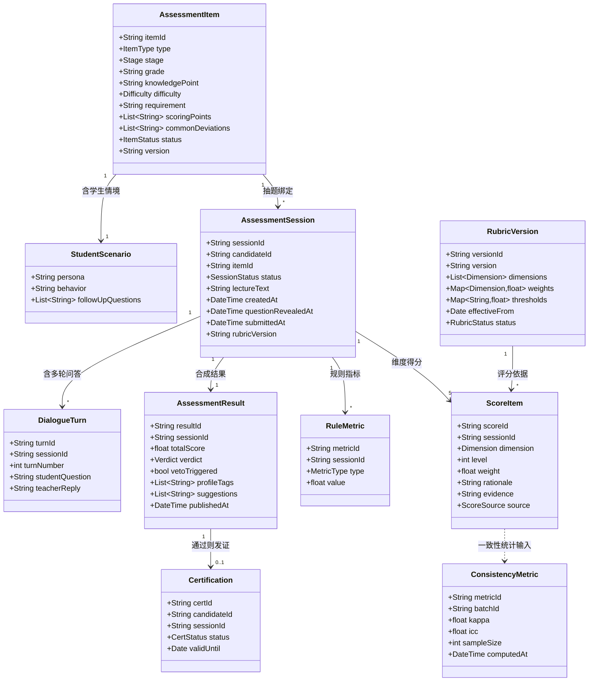
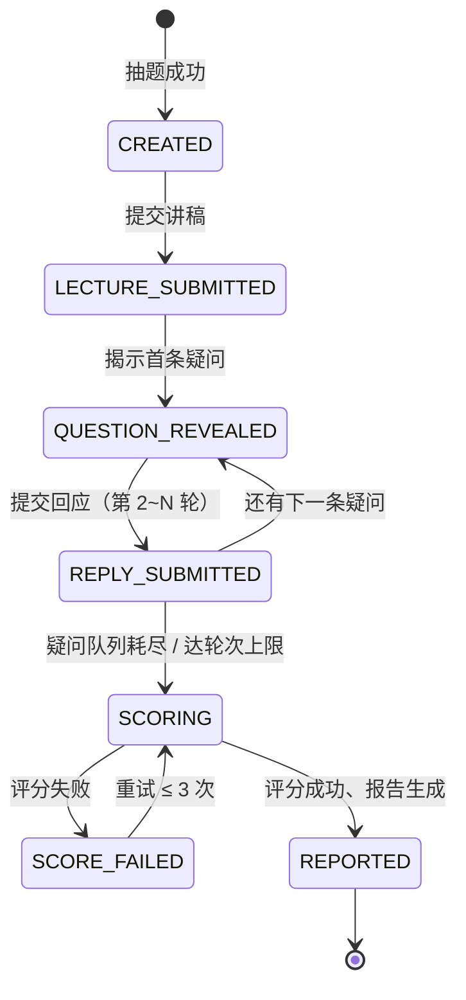

# 软件系统功能规格说明书

> 项目：教学能力评估智能体（约师）
> 版本：v1.1 ｜ 文档类型：需求阶段 — 功能需求规范
> 配套文档：[problem_definition.md](problem_definition.md) · [nonfunctional_spec.md](nonfunctional_spec.md)

---

## 0. 范围与边界

### 0.1 本系统是什么

本系统是**教学能力评估智能体**：给定一道初中数学题，试讲者提交**讲稿（文本）**，系统模拟学生进行**多轮文本问答**，AI 按 rubric 分维度打分，并输出能力报告与改进建议。

### 0.2 本规格覆盖范围（In Scope）

- 题目（题库）管理与抽题（题目中的"学生情境"由情景卡承载）
- 评估会话编排（试讲 1 轮讲稿 + 答辩多轮文本问答）
- AI 评分（rubric 分维度打分）+ 规则指标计算
- 能力报告与改进建议输出

### 0.3 明确排除范围（Out of Scope）

| 排除项 | 说明 |
|---|---|
| **学科知识准入测试** | 前置的知识测试模块**不属于本系统**，不做、不设计、不接口 |
| **音视频采集与语音转写** | 当前输入为**讲稿文本**，不采集音视频、不做 ASR |
| **人工复核** | **属下游产业环节**，由使用者接入后自行完成，不在本系统研究范围 |
| **申诉** | 属下游产业环节，不在本系统范围 |
| 其他学段与学科 | 小学 / 高中、语文 / 英语等，本版仅初中数学 |
| 实时语音交互 | 不含实时语音 AI 虚拟学生、打断处理、TTS |
| 视频多模态分析 | 不含表情 / 眼神 / 板书分析 |
| 家教平台业务功能 | 订单、支付、IM、老师主页展示、搜索推荐算法本身 |
| 教学培训与提升 | 本系统只做"测量"，不做"培训" |
| 实名 / 学籍认证 | 由外部系统提供，本系统仅消费认证结论 |

> **边界说明**：本系统只负责"评"。**人工复核由下游产业在使用我们的输出时自行完成**——因此本系统的输出必须**可复核**（含逐维度证据与理由），这是研究输出接入下游的接口约定。

---

## 1. 系统角色 (Actor)

| 编号 | 角色 | 类型 | 职责 |
|---|---|---|---|
| **AC-1** | **试讲者**（大学生） | 人 | 提交讲稿、逐轮回应学生文本疑问、查看报告 |
| **AC-2** | **评估管理员** | 人 | 管理题目题库、配置 rubric 与阈值 |
| **AC-3** | **评分引擎** | 系统 | LLM 分维度打分、规则指标计算、结果合成 |
| **AC-4** | **下游消费系统** | 系统 | 查询并消费评估结论（如推荐系统，并可自行接入人工复核） |

---

## 2. 功能树 (Feature Tree)

### FR-1 题目与题库管理

- **FR-1.1** 题目增删改查（含"学生情境"由情景卡承载）
- **FR-1.2** 题目字段完整性校验（必填项、评分要点、常见偏差）
- **FR-1.3** 题库批量导入 / 导出（CSV / JSON）
- **FR-1.4** 抽题：按题型 / 环节 / 难度加权随机
- **FR-1.5** 防泄题：轮换、限次、一题一用
- **FR-1.6** 题目启停用与版本管理

### FR-2 评估会话编排

- **FR-2.1** 发起评估会话（绑定试讲者与题目）
- **FR-2.2** 会话状态机流转与非法流转拦截
- **FR-2.3** 讲稿提交与作答限时
- **FR-2.4** 疑问后置揭示（首条疑问在讲稿提交后揭示，后续疑问逐轮揭示）
- **FR-2.5** 中断恢复与会话超时处理
- **FR-2.6** 评估次数与冷却期控制（未通过 7 天后可重考）
- **FR-2.7** 答辩环节多轮编排：逐轮揭示疑问 → 提交回应文本 → 队列耗尽或达轮次上限后进入评分

### FR-3 评分

- **FR-3.1** LLM 按 rubric 分维度打分
- **FR-3.2** 每个维度输出文字理由与证据引用
- **FR-3.3** 规则指标计算（口头禅频率、字数等，从讲稿文本计算）
- **FR-3.4** 讲错扣分（科学性错误归入讲解逻辑/表达清晰度，不单设维度）
- **FR-3.5** 总分合成与准入判定
- **FR-3.6** 评分失败重试
- **FR-3.7** 评分结果版本追溯

### FR-4 报告与输出

- **FR-4.1** 能力报告生成（总分 / 雷达图 / 标签 / 缺点与改进建议）
- **FR-4.2** 讲稿与问答存档（供下游复核回溯）
- **FR-4.3** 认证标识生成与有效期管理
- **FR-4.4** 下游系统查询接口

### FR-5 Rubric 与阈值配置

- **FR-5.1** Rubric 维度与分档描述配置
- **FR-5.2** 权重与准入阈值配置
- **FR-5.3** 版本管理与生效时间
- **FR-5.4** 配置变更回归验证

### FR-6 数据与质量分析

- **FR-6.1** 标注数据集沉淀（AI 分 vs 专家分，研究验证用）
- **FR-6.2** 一致性指标计算（Kappa / ICC）
- **FR-6.3** 分维度分布与区分度统计
- **FR-6.4** 操作审计日志

---

## 3. 领域模型 (Domain Model UML)



---

## 4. 关键状态机：评估会话



**关键约束**：首条 `QUESTION_REVEALED` 状态**必须**在 `LECTURE_SUBMITTED` 之后才可到达，系统不得在讲稿提交前向试讲者暴露任何疑问；后续疑问仅在上一条回应提交（`REPLY_SUBMITTED`）后揭示。评分完成即进入 `REPORTED`（报告输出），**无人工复核环节**。

---

## 5. 功能需求明细

> 优先级：**P0** = 第一版必须实现；**P1** = 第一版应有，可稍后；**P2** = 可延后

| 编号 | 需求 | 输入 | 输出 | 优先级 |
|---|---|---|---|---|
| FR-1.1 | 题目增删改查 | 题目字段 | 题目记录 | P0 |
| FR-1.2 | 字段完整性校验 | 题目字段 | 校验结果 / 错误项 | P0 |
| FR-1.3 | 题库批量导入导出 | CSV / JSON | 导入报告 | P1 |
| FR-1.4 | 加权随机抽题 | 题型 / 环节 / 难度 | 题目 | P0 |
| FR-1.5 | 防泄题（轮换、限次、一题一用） | 试讲者 ID、历史记录 | 可用题目集合 | P0 |
| FR-1.6 | 题目启停用与版本 | 版本操作 | 题目状态 | P1 |
| FR-2.1 | 发起评估会话 | 试讲者 ID、题目 ID | 会话 ID | P0 |
| FR-2.2 | 状态机流转与非法拦截 | 流转请求 | 新状态 / 拒绝 | P0 |
| FR-2.3 | 讲稿提交与作答限时 | 会话 ID | 倒计时 / 超时事件 | P1 |
| FR-2.4 | 疑问后置揭示 | 会话 ID | 疑问文本 | P0 |
| FR-2.5 | 中断恢复与超时处理 | 会话 ID | 恢复会话 / 关闭会话 | P1 |
| FR-2.6 | 次数与冷却期控制 | 试讲者 ID | 是否可发起 | P1 |
| FR-2.7 | 答辩多轮编排 | 疑问队列 | 逐轮回应 / 结束 | P0 |
| FR-3.1 | LLM 分维度打分 | 讲稿 + 问答文本、rubric | 维度得分 | P0 |
| FR-3.2 | 维度文字理由与证据 | 评分上下文 | 理由 + 证据文本 | P0 |
| FR-3.3 | 规则指标计算 | 讲稿 + 问答文本 | 口头禅频率 / 字数 | P1 |
| FR-3.4 | 讲错扣分 | 讲稿中的科学性错误 | 维度降档 | P0 |
| FR-3.5 | 总分合成与判定 | 维度得分、权重、阈值 | 总分、结论 | P0 |
| FR-3.6 | 评分失败重试 | 失败任务 | 重试结果 | P0 |
| FR-3.7 | 评分版本追溯 | 会话 ID | rubric / 模型版本 | P0 |
| FR-4.1 | 能力报告生成 | 评估结果 | 报告（含雷达图、建议） | P0 |
| FR-4.2 | 讲稿与问答存档 | 会话数据 | 存档记录 | P1 |
| FR-4.3 | 认证标识与有效期 | 评估结果 | 认证记录 | P1 |
| FR-4.4 | 下游系统查询接口 | 试讲者 ID | 评估结论 | P0 |
| FR-5.1 | Rubric 配置 | 维度、分档描述 | rubric 定义 | P0 |
| FR-5.2 | 权重与阈值配置 | 参数 | 配置生效 | P0 |
| FR-5.3 | 版本管理与生效时间 | 版本操作 | 版本记录 | P1 |
| FR-5.4 | 配置变更回归验证 | 新配置、回归集 | 验证报告 | P2 |
| FR-6.1 | 标注数据沉淀 | 评分与专家评分记录 | 标注数据集 | P1 |
| FR-6.2 | 一致性指标计算 | 标注数据集 | Kappa / ICC | P1 |
| FR-6.3 | 分布与区分度统计 | 评分记录 | 统计报表 | P2 |
| FR-6.4 | 操作审计日志 | 操作事件 | 审计日志 | P0 |

---

## 6. 核心业务流程

```
试讲者发起评估（FR-2.1）
  ↓
加权抽题（FR-1.4 / FR-1.5）—— 只展示题干与学生人设
  ↓
试讲环节：提交讲稿（FR-2.3）
  ↓
揭示首条疑问（FR-2.4）
  ↓
答辩环节：多轮循环（FR-2.4 / FR-2.7）
  ├─ 揭示下一条疑问 → 提交回应文本
  └─ 疑问队列耗尽 / 达轮次上限 → 结束
  ↓
AI 评分（FR-3.1~3.5）+ 规则指标（FR-3.3）
  ↓
报告与认证（FR-4.1 / FR-4.3 / FR-4.4）
  ↓
（下游自行决定是否人工复核）
```
