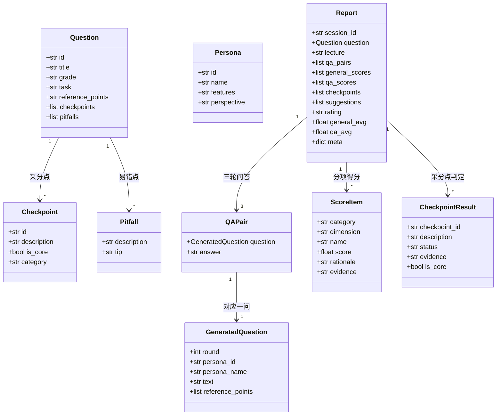
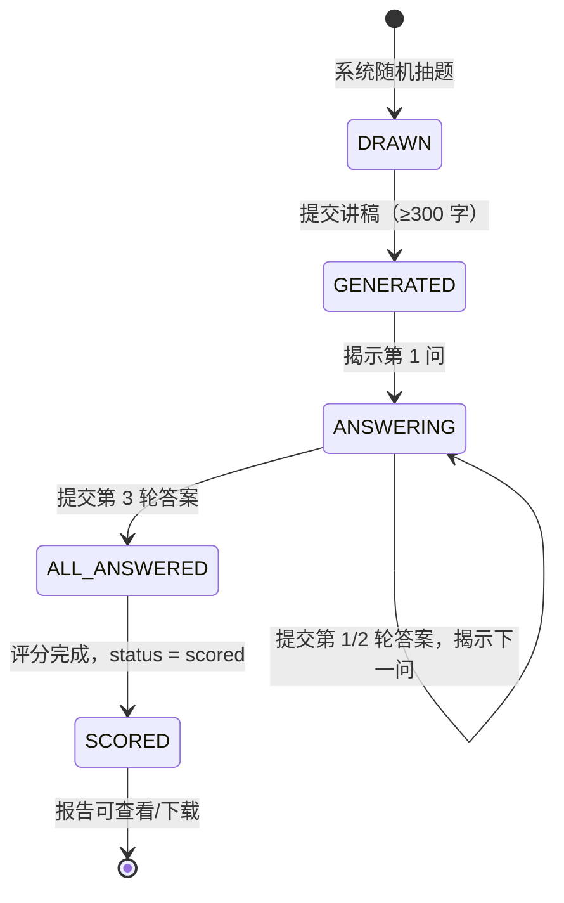

# 软件系统功能规格说明书

> 项目：教学能力评估智能体（约师 / EduEval）
> 版本：**v3.0（实现对齐版）** ｜ 日期：2026-11-19 ｜ 文档类型：需求阶段 — 功能需求规范
> 配套文档：[problem_definition.md](problem_definition.md) · [nonfunctional_spec.md](nonfunctional_spec.md) · [../software/architecture.md](../software/architecture.md) · [../software/design.md](../software/design.md)

---

## 0. 范围与边界

### 0.1 本系统是什么

本系统是**讲题教学能力评估工具**，已实现为**可运行的单机软件**，有两个入口、同一套逻辑：

| 入口 | 形态 | 启动方式（在 `EduEval/` 目录下） |
|---|---|---|
| **CLI** | 终端交互 | `python run.py run` |
| **Web** | 浏览器单页（FastAPI + 原生 HTML/JS，无前端框架） | `python web.py --port 8000` |

一次评估：

1. 系统从题库**随机抽** 1 道初中数学讲题（**抽题环节不给学生人设**，被试不能自选）；
2. 被试提交**逐字讲稿**（≥ 300 字）；
3. 系统从 5 类虚拟学生中抽 3 类，各生成 1 个问题（共 3 问，互不重复），并同步产出「参考应答要点」；
4. 被试**按序**逐轮作答（答完第 N 问才揭示第 N+1 问）；
5. LLM 按「通用标准 3 项 + 特殊标准（采分点）+ 问答标准 3 项」评分；
6. 输出**评级 + 分项得分 + 理由/证据 + 改进建议**的 Markdown 报告。

### 0.2 状态标注约定

| 标记 | 含义 |
|---|---|
| ✅ | 已实现，可运行、有测试或手工验证 |
| 🟡 | 部分实现（有简化/限制，见备注） |
| ⬜ | 本版未实现（列入待办或后续扩展） |

### 0.3 本版相对 v2.0 的主要变化

| 变化 | 内容 |
|---|---|
| **形态收敛** | 从「设计中的服务」收敛为**单机工具**：无账号、无数据库、无后台任务队列；会话以 `workspace/<sessionId>/session.json` 为唯一事实源 |
| **双入口** | 新增 Web 入口（FastAPI + 静态页）；CLI 与 Web 共用同一会话文件（`session.json`），任一端都能从磁盘读回进度 |
| **抽题归系统** | 抽题由系统随机完成（`draw_question`），被试不能选题；Web 端只提供「换一题」 |
| **逐轮揭示落为服务端规则** | 未到轮次的问题文本不下发；跳轮作答返回 409 |
| **评分实现为单次调用** | v2.0 规划的 N=3 独立采样取中位数**尚未实现**（`meta.samples = 1`） |
| **报告排版归一** | 新增 `mathfmt.normalize_math`：`^` 次方转 Unicode 上标；表格单元格 `|` 转义，防止 Markdown 表格错列 |
| **多项 v2.0 功能降级/未实现** | batch 批量、Kappa/ICC 统计、合理性自动校验、失败降级、防泄题、CSV 导入导出等（见 §7） |

### 0.4 明确排除范围（Out of Scope）

| 排除项 | 说明 |
|---|---|
| **学科知识准入测试** | 默认被试已掌握学科知识（见 `基本假设.txt`） |
| **人工复核 / 申诉** | 属下游环节，由使用者接入后自行完成 |
| **听觉评估**（连贯性、口齿） | 后续扩展模块 |
| **视觉评估**（读稿、板书） | 后续扩展模块 |
| **音视频采集 / 视频转录** | 本版纯文本输入 |
| 其他学段学科 | 仅初中数学 |
| 平台业务功能 | 订单、支付、IM、推荐算法、老师主页 |
| 实名 / 学籍认证 | 由外部系统提供 |
| 账号体系 / 权限模型 | 单机工具，默认一人使用 |

> **边界说明**：本系统只负责「评」。输出必须**可复核**（逐项理由 + 原文证据），供下游自行开展人工复核。

---

## 1. 系统角色 (Actor)

| 编号 | 角色 | 类型 | 职责 | 状态 |
|---|---|---|---|---|
| **AC-1** | **被试者**（大学生） | 人 | 用 CLI 或浏览器：查看抽到的题、提交讲稿、逐轮作答、查看/下载报告 | ✅ |
| **AC-2** | **维护者** | 人 | 以**文件**方式维护题库（JSON）、学生人设、提示词、`config.yaml`；非图形化后台 | ✅ |
| **AC-3** | **提问引擎** | 系统 | 抽 3 类人设、生成 3 问与参考应答要点、生成后做去重粗筛 | ✅ |
| **AC-4** | **评分引擎** | 系统 | 按三层标准评分、执行门槛规则、合成评级、生成改进建议 | ✅ |
| **AC-5** | **下游消费方** | 人/系统 | 读取 `workspace/<id>/report.md`（或 Web 下载），自行开展人工复核 | ✅ |

> 无登录/鉴权：Web 端会话仅靠 sessionId 标识（`EV-YYYYMMDD-HHMMSS`），非法编号返回 400，不存在返回 404。

---

## 2. 功能需求

### FR-1 题库与抽题

| 编号 | 功能 | 说明 | 状态 |
|---|---|---|---|
| FR-1.1 | 题库文件化 | 每题一个 JSON：`datasets/questions/<id>.json`，含题干、年级、任务描述、采分点、易错点、参考要点 | ✅ |
| FR-1.2 | 采分点维护 | 采分点写在题目 JSON 内，`is_core` 标记核心项（M-CZ-001 共 8 条，仅 `CP-6` 为核心） | ✅ |
| FR-1.3 | 题目列表 | `python run.py list [--json]`；Web `GET /api/questions` | ✅ |
| FR-1.4 | **系统随机抽题** | `draw_question(seed)`：默认 `SystemRandom`；`--seed` 可复现；题库空抛「题库为空，无法抽题」 | ✅ |
| FR-1.5 | 换一题 | Web 首屏「换一题」按钮 → `GET /api/draw` | ✅ |
| FR-1.6 | 复现指定题 | `--question M-CZ-001`（**仅用于复现实验**，不作为被试自选入口） | ✅ |
| FR-1.7 | 题库导入/导出（CSV） | v2.0 设想，未实现 | ⬜ |
| FR-1.8 | 防泄题（短期不重复抽同题） | 未实现，题库仅 1 题也无从去重 | ⬜ |
| FR-1.9 | 题目启停用 / 版本管理 | 未实现 | ⬜ |

### FR-2 评估会话编排

| 编号 | 功能 | 说明 | 状态 |
|---|---|---|---|
| FR-2.1 | 发起会话 | CLI `run --lecture`；Web `POST /api/sessions`（201） | ✅ |
| FR-2.2 | 讲稿校验 | 字数下限 300：CLI 不足直接报错退出；Web 端返回 422。回答不足 50 字时 CLI 重问、Web 拒绝 | ✅ |
| FR-2.3 | 讲稿提交后生成问题 | 讲稿落盘后抽人设 + 生成 3 问 + 参考要点，一次完成 | ✅ |
| FR-2.4 | **逐轮揭示** | 第 N+1 问仅在答完第 N 轮后可读；Web 服务端计算 `revealed`，未揭示返回空串 | ✅ |
| FR-2.5 | 固定 3 轮、按序作答 | 跳轮作答返回 `409 请先回答第 1 轮`；已评分后不可再改回答（409） | ✅ |
| FR-2.6 | 每步落盘 | 讲稿、每轮回答、评分结果逐步写入 `session.json` | ✅ |
| FR-2.7 | 中断续跑 | CLI `--session EV-xxx`；Web 刷新由 localStorage 恢复，服务重启从磁盘加载 | ✅ |
| FR-2.8 | 幂等评分 | 重复调用评分接口直接返回已有结果，不重复计费 | ✅ |
| FR-2.9 | 自动续跑（免手输路径） | 设想：启动时检查 workspace 有未完成会话则自动续跑，完成后移入已完成目录（见 `todo.txt`） | ⬜ |
| FR-2.10 | 会话超时 / 冷却期 / 评估次数限制 | 未实现 | ⬜ |

### FR-3 虚拟学生提问生成

| 编号 | 功能 | 说明 | 状态 |
|---|---|---|---|
| FR-3.1 | 学生人设库 | 5 类：概念严谨型 / 基础困惑型 / 迁移应用型 / 拓展挑战型 / 批判反思型 | ✅ |
| FR-3.2 | 抽 3 类人设 | `random.sample`，互不重复 | ✅ |
| FR-3.3 | 生成问题 | 输入「题目 + 3 类人设 + 讲稿 + 易错点」，一次生成 3 问 | ✅ |
| FR-3.4 | 生成参考应答要点 | 每问 2~3 条，仅用于评分，**不下发给被试** | ✅ |
| FR-3.5 | **互不重复校验** | 生成后按关键词组（`_TOPIC_GROUPS`）判定；不通过则重试（最多 3 次，温度递增） | 🟡 关键词粗筛，非语义判定 |
| FR-3.6 | 合理性校验（人设贴合/可答） | 仅靠提示词约束，无独立校验器 | 🟡 |
| FR-3.7 | 失败降级 | 重试 3 次仍不合格：采用最后一次结果并在报告提示；无「预置问题」兜底；完全无输出才报错 | 🟡 |
| FR-3.8 | dry-run 桩模式 | 无 API key 也能跑通全链路（5 类桩数据结构与真实返回一致） | ✅ |

### FR-4 评分

| 编号 | 功能 | 说明 | 状态 |
|---|---|---|---|
| FR-4.1 | 通用标准评分 | G1 教学目标与设计 / G2 教学内容与学科素养 / G3 教学实施与方法，1~5 分 + 理由 + 原文证据 | ✅ |
| FR-4.2 | 特殊标准判定 | 采分点逐条判「覆盖 / 部分覆盖 / 未覆盖」+ 证据 | ✅ |
| FR-4.3 | 问答标准评分 | Q1 应答切题 / Q2 因材施教 / Q3 启发引导，每轮 3 项，共 9 项 | ✅ |
| FR-4.4 | **门槛规则** | 核心采分点未覆盖 → 评级上限「待改进」；覆盖不足半数 → 同样封顶 | ✅ |
| FR-4.5 | 评级合成 | 总均分 = (讲稿均分 + 问答均分) / 2；≥4.5 优秀、≥3.8 良好、≥3.0 合格，其余待改进 | ✅ |
| FR-4.6 | 「不合格」档位 | 文档五档含「不合格」，实现只有四档（最低即待改进） | 🟡 待定是否启用 |
| FR-4.7 | 改进建议 | 仅针对失分项，标注【讲稿】/【问答】 | ✅ |
| FR-4.8 | 多轮采样取中位数（N=3） | v2.0 设计，未实现；当前单次调用 | ⬜ |
| FR-4.9 | 评分版本追溯 | `meta` 记 model / 调用次数 / token / 时间；提示词版本未入库 | 🟡 |

### FR-5 报告与建议

| 编号 | 功能 | 说明 | 状态 |
|---|---|---|---|
| FR-5.1 | Markdown 报告 | `workspace/<id>/report.md`：报告头 / 评级 / 得分总览 / 讲稿评估 / 采分点表 / 问答评估 / 建议 / 附录 | ✅ |
| FR-5.2 | 逐项理由与证据 | 每个评分项附理由与原文引用；采分点表含 ✅/⚠️/❌ 与证据 | ✅ |
| FR-5.3 | 网页展示 | 评级 hero、统计卡、评分条、采分点表、每轮问答折叠、建议列表 | ✅ |
| FR-5.4 | 报告下载 | `GET /api/sessions/{id}/report.md`（纯文本下载） | ✅ |
| FR-5.5 | **排版归一** | `normalize_math`：`10^5`→`10⁵`、`10^-4`→`10⁻⁴`；落单 `^` 转义；`$…$` 不动 | ✅ |
| FR-5.6 | 表格安全 | 单元格内 `|` 转义为 `\|`、换行压平，避免表格错列 | ✅ |
| FR-5.7 | 下游查询接口 | 无独立查询 API；以下载 Markdown 为准 | 🟡 |

### FR-6 配置与标准

| 编号 | 功能 | 说明 | 状态 |
|---|---|---|---|
| FR-6.1 | 运行配置 | `config.yaml`：模型、温度（提问 0.8 / 评分 0.5 / 建议 0.7）、字数上下限、轮次、人设数、路径 | ✅ |
| FR-6.2 | 密钥管理 | `.env`（`LLM_API_KEY` / `LLM_BASE_URL` / `LLM_MODEL`），`.gitignore` 排除 | ✅ |
| FR-6.3 | 评分标准 | 全部写在 `edu_eval/prompts/*.md`（rubric 内嵌），便于版本化 | ✅ |
| FR-6.4 | 评级阈值 / 权重 | 阈值硬编码于 `scorer.make_rating`；未做权重配置 | 🟡 |
| FR-6.5 | 评分参照物（示例讲稿/答案） | `datasets/examples/` 提供高质量讲稿与答案示例，供人工对齐与提示词演示 | ✅ |

### FR-7 数据与质量分析

| 编号 | 功能 | 说明 | 状态 |
|---|---|---|---|
| FR-7.1 | 会话数据沉淀 | `session.json`（讲稿、问题、回答、评分）+ `report.md` | ✅ |
| FR-7.2 | 运行元信息 | `meta`：时间、模型、`samples`、调用次数、token、是否 dry-run | ✅ |
| FR-7.3 | 批量评测（batch） | 未实现 | ⬜ |
| FR-7.4 | Kappa / ICC 一致性统计 | 未实现 | ⬜ |
| FR-7.5 | 分项分布与区分度 | 未实现 | ⬜ |
| FR-7.6 | 审计日志 | 未实现（单机工具，文件即记录） | ⬜ |

### FR-8 扩展预留

| 编号 | 功能 | 状态 |
|---|---|---|
| FR-8.1 | 评分标准按文本/听觉/视觉分模块组织 | ⬜ |
| FR-8.2 | 视频 → 逐字讲稿的转录接口 | ⬜ |
| FR-8.3 | 多学科数据结构预留 | ⬜ |

### FR-9 Web 接口（本版新增）

| 方法 | 路径 | 说明 | 主要错误码 |
|---|---|---|---|
| GET | `/` | 返回 `static/index.html`（`Cache-Control: no-cache`） | — |
| GET | `/api/config` | 模型、是否有 key、dry-run 默认值、轮次、字数控 | — |
| GET | `/api/questions` | 题目列表（只读） | — |
| GET | `/api/draw` | 随机抽题；带 `questionId` 则仅恢复该题 | 404 / 503 |
| POST | `/api/sessions` | 建会话：讲稿 + 抽题 + 生成 3 问（201） | 422 / 404 / 502 / 503 |
| GET | `/api/sessions/{id}` | 会话详情（含已揭示问题，未揭示文本为空） | 400 / 404 |
| POST | `/api/sessions/{id}/answers` | 提交某轮回答（按序校验） | 400 / 404 / 409 / 422 |
| POST | `/api/sessions/{id}/score` | 评分（幂等，已评直接回放） | 400 / 404 / 409 / 502 / 503 |
| GET | `/api/sessions/{id}/report.md` | 下载 Markdown 报告 | 400 / 404 / 409 |
| GET | `/api/health` | 健康检查 | — |

**接口约束**：

1. 未揭示问题只返回空串，`reference_points` 从不下发；
2. 跳轮作答返回 409（提示应先答第几轮）；
3. 已评分会话不可再提交回答；
4. 会话号必须匹配 `^EV-[0-9A-Za-z\-]+$`。

---

## 3. 领域模型（与实现一致）



> 说明：v2.0 的 13 实体（QuestionItem / AssessmentSession / RubricConfig / ConsistencyMetric 等）是实现前的设计模型；当前实现是**文件 + 轻量 dataclass**，没有持久化 ORM 层。

---

## 4. 会话状态机（实现版）



**关键约束**：

1. 抽题 → 讲稿 → 问题生成是单向的：讲稿提交前不暴露任何人设与问题；
2. 问题**逐轮揭示**：第 N+1 问只在第 N 轮回答落盘后可见；
3. 固定 **3 轮**，跳轮/倒序作答被拒绝；
4. 评分完成后会话冻结（`status = scored`），回答不可再改；
5. 持久化：Web 侧记 `status`（`answering` / `scored`）与已答轮次；CLI 侧以 `qa[].answer` 与 `rating` 是否存在推断进度。

---

## 5. 核心业务流程

### 5.1 CLI

```
python run.py run [--dry-run]
  ① 随机抽题，打印题面与任务（不含人设）
  ② 读取讲稿文件（--lecture），校验 ≥300 字
  ③ 生成 3 问 + 参考要点
  ④ 逐轮打印问题 → 多行输入回答（空行结束，可 r 重写 / q 退出）
     每答一轮立即写 session.json
  ⑤ 评分 → 生成 report.md → 打印摘要（评级、采分点覆盖数）
  续跑：--session EV-xxxx；非交互作答：--answers answers.json
```

### 5.2 Web

```
浏览器 → GET / 加载单页
  ① 服务端随机抽题（GET /api/draw）→ 显示题面 +「换一题」
  ② 粘贴讲稿 →「开始评估」→ POST /api/sessions（201）
  ③ 逐轮回答：POST /api/sessions/{id}/answers
     未到轮次的问题文本为空；答完当前轮才出现下一问
  ④「生成评估报告」→ POST /api/sessions/{id}/score
  ⑤ 报告页：评级、统计卡、评分条、采分点表、问答、建议、下载 Markdown
  刷新页面：localStorage 里的 sessionId → GET /api/sessions/{id} 恢复
```

---

## 6. 关键数据规格

### 6.1 题目（`datasets/questions/<id>.json`）

| 字段 | 必填 | 说明 |
|---|---|---|
| `id` | ✓ | 如 `M-CZ-001` |
| `title` | ✓ | 课题名（如「科学记数法」） |
| `grade` | ✓ | 学段年级（如「七年级」） |
| `task` | ✓ | 讲题任务描述（被试看到的话） |
| `reference_points` | ✓ | 优质讲稿应覆盖的要点 |
| `checkpoints[]` | ✓ | `{id, description, is_core, category}`，M-CZ-001 共 8 条 |
| `pitfalls[]` | ✓ | `{description, tip}`，作为提问素材 |

### 6.2 学生人设（`datasets/personas/personas.json`）

| 字段 | 说明 |
|---|---|
| `id` | `P1`~`P5` |
| `name` | 类型名（概念严谨型 / 基础困惑型 / 迁移应用型 / 拓展挑战型 / 批判反思型） |
| `features` | 典型表现 |
| `perspective` | 提问视角（供生成时贴合人设） |

### 6.3 会话（`workspace/<sessionId>/session.json`）

**公共字段**（CLI 与 Web 都会写）：

```json
{
  "sessionId": "EV-20261119-153000",
  "questionId": "M-CZ-001",
  "candidateId": "web-user",
  "lecture": "……逐字讲稿……",
  "qa": [
    {
      "round": 1,
      "personaId": "P1",
      "personaName": "概念严谨型",
      "questionText": "……",
      "referencePoints": ["……"],
      "answer": "……"
    }
  ],
  "rating": "合格",
  "meta": { "time": "2026-11-19 15:30", "dry_run": false }
}
```

**入口差异**：

| 字段 | CLI | Web | 说明 |
|---|---|---|---|
| `status` | — | `answering` / `scored` | Web 用它做冻结判断；CLI 以是否已有 `rating` 推断 |
| `report` | — | 报告的前端结构化载荷 | Web 报告页直接回放，避免重复计算 |
| `meta.calls` / `meta.tokens` / `meta.model` / `meta.samples` | 🟡 视运行方式 | 🟡 | 真实调用时记录；dry-run 下部分字段缺省 |

### 6.4 运行配置（`config.yaml`）

| 配置项 | 默认值 | 说明 |
|---|---|---|
| `llm.base_url` / `llm.model` | `https://api.deepseek.com` / `deepseek-chat` | OpenAI 兼容接口 |
| `temperature.qa` / `.score` / `.suggestion` | 0.8 / 0.5 / 0.7 | 三阶段采样温度 |
| `limits.min_script_words` | 300 | 讲稿字数下限 |
| `limits.min_answer_words` | 50 | 单轮回答字数下限 |
| `limits.max_script_words` | 8000 | 讲稿截断上限（超长截断并标注） |
| `qa.rounds` / `qa.persona_count` | 3 / 3 | 固定 3 轮、5 选 3 |
| `paths.datasets` / `paths.workspace` | `datasets` / `workspace` | 相对路径 |

### 6.5 报告章节

报告头（编号/题目/字数/时间）→ 评级 → 得分总览 → 一、讲稿评估（G1~G3，理由 + 证据）→ 特殊标准 · 采分点判定表（✅ 覆盖 / ⚠️ 部分覆盖 / ❌ 未覆盖）→ 二、问答评估（逐轮提问/回答/评分表）→ 三、改进建议 → 附录元信息。

---

## 7. 未实现清单与后续

| 优先级 | 项 | 关联需求 |
|---|---|---|
| P0 | **跑一次真实 LLM 全链路**（当前验证以 dry-run 为主） | FR-3 / FR-4 |
| P0 | 补齐其余 8 道真题及逐题采分点 | FR-1.1 |
| P1 | **N=3 独立采样取中位数**（程序侧调 3 次，无状态） | FR-4.8 |
| P1 | batch 批量评测 + Kappa/ICC 一致性统计 | FR-7.3 / FR-7.4 |
| P1 | 通用 3 项、问答 3 项的 1~5 档位描述细化（当前写在提示词中） | FR-6.3 |
| P1 | 3 问「互不重复」的可靠机器判定（现为关键词粗筛） | FR-3.5 |
| P2 | 生成失败降级为预置问题 | FR-3.7 |
| P2 | 自动续跑：启动时扫 workspace，完成后归档 | FR-2.9 |
| P2 | 「不合格」档位是否启用、权重是否引入 | FR-4.5 / FR-4.6 |
| P3 | CSV 导入导出、防泄题、题目启停用 | FR-1.7~1.9 |