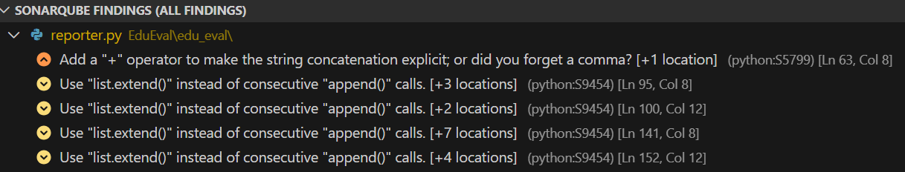
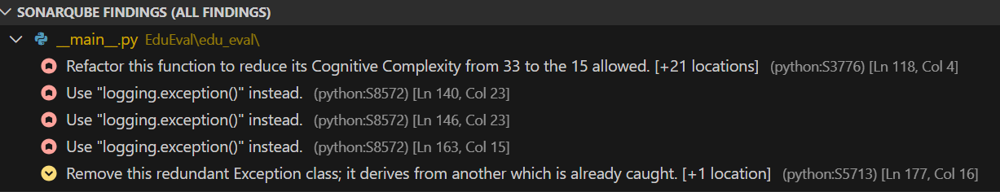
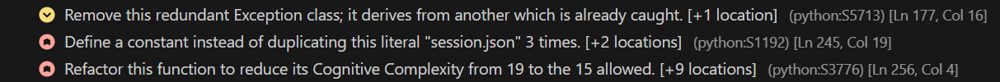
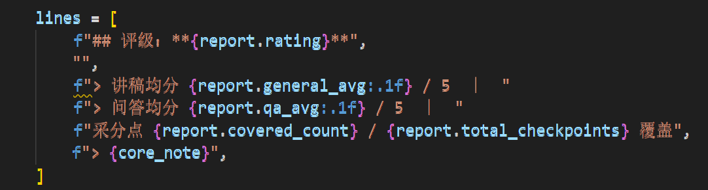
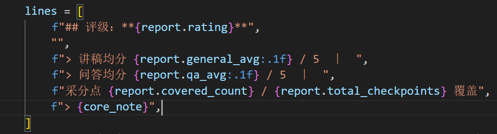
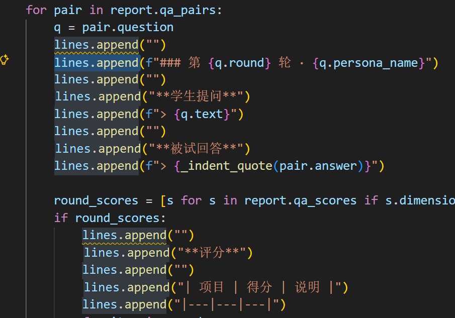
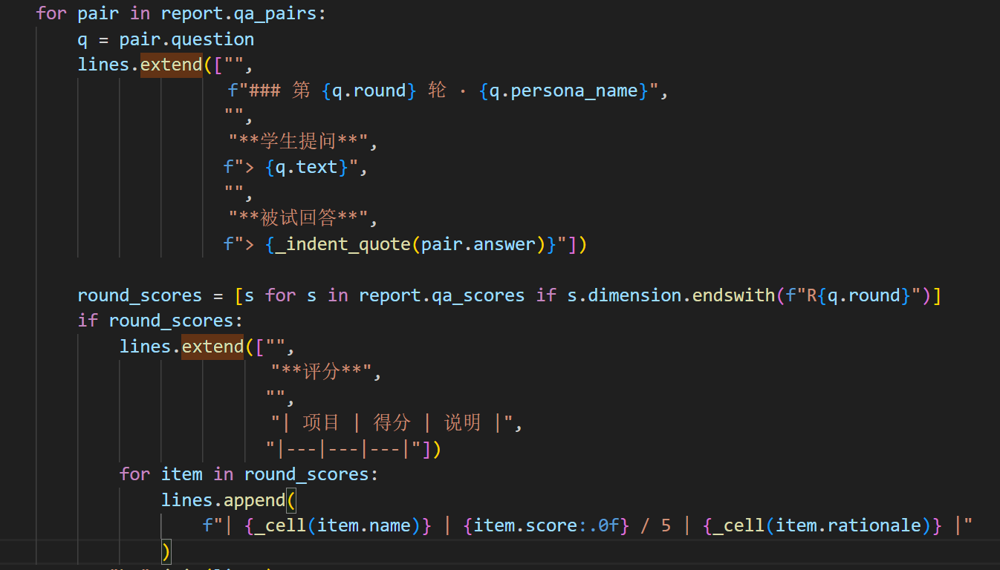
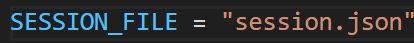
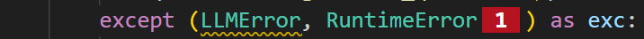
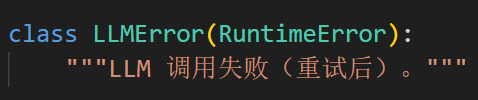

### 扫描报告（SonarQube）

修复1：修复report.py的第一个问题。
修复2：改进report.py的第2-5个问题（属同一类问题）。

修复3：改进main的第3-5个问题（属同一个问题），因为第一个和最后一个问题（属同一个问题，即大量if和while结构铺开）受到程序功能的约束，难以再优化。
修复4：改进main的第7个问题。
修复5：改进

### 修复1

AI生成的不知为何没有用逗号隔开。改后：

### 修复2

通过extend列表来替代连续多个append单元素。改后：

### 修复3
将logger.error替换为logger.exception。

### 修复4
问题在于全篇多处使用"session.json"，可以在一开始开一个常量保存。

### 修复5

LLMError继承自RuntimeError，因此重复了，如下图所示，去除RuntimeError即可。

### 改进后
除了main.py两个降低代码复杂度的建议外，其余后端程序均 No SonarQube issues to display.