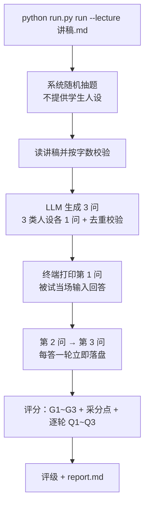

# 教学能力评估 · 原型设计

> 版本：v0.2（与实现对齐）　｜　依据：[problem_definition.md](../requirements/problem_definition.md)、[functional_spec.md](../requirements/functional_spec.md)、[architecture.md](architecture.md)
> 形态：**本地命令行 + 可选本地 Web**，无前后端分离、无数据库——输入文本，输出 Markdown 报告。
> 上一版 v0.1 是本项目开工前的纸面原型，v0.2 按 `EduEval/` 的实际实现逐节校正；差异见 [§8](#8-与-v01-原型的差异)。

---

## 1. 产品定位与目标用户

| 项 | 内容 |
|---|---|
| 一句话定位 | 给定一道初中数学讲题，被试提交逐字讲稿、答 3 个虚拟学生的提问，系统输出**评级 + 分项得分 + 改进建议** |
| 核心价值 | 把"会不会讲课"变成**可测量、可比较、可复现**的评估；每个扣分都有**理由 + 原文证据** |
| 形态 | ① CLI：`python run.py run --lecture 讲稿.md`；② Web：`python web.py`（原生 HTML/JS，一屏一阶段） |
| 目标用户 | ① 被试（大学生家教）：想知道自己讲得怎么样；② 研究者：检验评估方法是否可靠；③ 下游平台：消费评级结果 |
| 非目标 | 不做账号体系、不做题库管理界面、不做人工复核（复核由下游平台做）、不做音视频采集 |

### 典型场景

| 场景 | 输入 | 输出 |
|---|---|---|
| 单次评估（CLI） | 讲稿文件 + 终端逐轮输入回答 | `report.md` + `session.json` |
| 单次评估（Web） | 文本框讲稿 + 三张问答卡 | 报告页 + 下载 Markdown |
| 中断续跑 | 已有 `workspace/<EV-…>/session.json` | 从断点继续，不重复已答轮次 |
| 非交互回放 | `--answers` JSON（讲稿与答案都来自文件） | 可脚本化、可批量 |
| 批量评测（**未实现**） | 一批 JSON 样本 | 批量报告 + Kappa/ICC |

---

## 2. 信息架构

### 2.1 目录与文件结构

```text
yueshi/
├── EduEval/                          # 可运行程序（本项目主体）
│   ├── run.py                        # CLI 入口，等价于 python -m edu_eval
│   ├── web.py                        # FastAPI 入口（复用同一套 edu_eval 逻辑）
│   ├── config.yaml                   # 模型、温度、字数下限、轮数
│   ├── .env                          # 密钥与 base_url（不入库）
│   ├── requirements.txt / setup.py
│   ├── edu_eval/
│   │   ├── __main__.py               # argparse + 主流程编排
│   │   ├── assets.py                 # 题库/人设/提示词加载、随机抽题
│   │   ├── config.py                 # config.yaml + .env 合并
│   │   ├── llm.py                    # OpenAI 兼容客户端、重试、dry-run 桩
│   │   ├── logs.py                   # 日志初始化（stderr）
│   │   ├── mathfmt.py                # ^ 次方 → Unicode 上标
│   │   ├── models.py                 # 9 个 dataclass
│   │   ├── qa_gen.py                 # 3 问生成 + 合理性/去重校验
│   │   ├── scorer.py                 # 评分、门槛规则、评级合成
│   │   ├── reporter.py               # 报告 Markdown 拼装
│   │   └── prompts/                  # 5 个提示词模板（业务规则所在）
│   ├── datasets/
│   │   ├── questions/                # 题目 JSON（当前 1 道：M-CZ-001）
│   │   ├── personas/personas.json    # 5 类虚拟学生
│   │   └── examples/                 # 高质量讲稿、答案示例
│   ├── static/                       # index.html / style.css / app.js
│   ├── tests/                        # 36 个测试（dry-run 桩，不调 LLM）
│   └── workspace/
│       └── EV-20261119-105054/
│           ├── session.json          # 会话状态（单一事实源）
│           └── report.md             # 最终报告
├── docs/
│   ├── requirements/                 # 需求三件套
│   ├── research/                     # 文献精读
│   └── software/                     # 本目录：设计/架构/质量/评审/部署
└── 虚拟学生类型划分.md                # 人设原始定义（人工资料）
```

> **设计要点**
> - **讲稿走文件或大文本框**：1000+ 字，编辑器里写更现实；Web 端用 textarea。
> - **问答走终端或卡片**：问题在被试提交讲稿后才揭示，一问一答，不给"先看三问再组织答案"的机会。
> - **不存中间文件**：问答内容直接进 `session.json`，报告直接从内存渲染。

### 2.2 用户流程



Web 端是同一流程的图形版：抽题 → 交讲稿 → 逐轮卡片 → 报告页；服务端同样逐轮揭示（未答完的题 `text` 返回空串）。

### 2.3 会话文件（`session.json`）—— 单一事实源

真实结构（`workspace/EV-20261119-105054/session.json`，节选）：

```json
{
  "sessionId": "EV-20261119-105054",
  "questionId": "M-CZ-001",
  "candidateId": "web-user",
  "lecture": "这个视频你先来找找十的乘方的规律……",
  "status": "scored",
  "qa": [
    {
      "round": 1,
      "personaId": "P2",
      "personaName": "基础困惑型",
      "questionText": "老师，您说“指数就是小数点移动的位数”，可我数 2015 时有点乱……",
      "referencePoints": ["把 2015 看成小数点默认在个位后面……", "……"],
      "answer": "同学，如果遇到 20151.6 这样的数……"
    }
  ],
  "meta": { "dry_run": false, "time": "2026-11-19 11:00" },
  "rating": "待改进",
  "report": { "general": [], "checkpoints": [], "qa": [], "suggestions": [] }
}
```

| 字段 | 说明 |
|---|---|
| `status` | `answering`（问答中）/ `scored`（已评分）。CLI 中途落盘时写 `in_progress`，Web 只写前两者 |
| `qa[]` | 每轮的提问、人设、**参考应答要点**与回答；未答轮次也保留（`answer` 为空） |
| `rating` / `report` | 评分后追加；`report` 是渲染报告所需的结构化 payload，CLI 不写（详见 §6.3） |
| `meta` | `dry_run`、时间；CLI 的 `meta` 还含模型、调用次数、token |

**为什么用 JSON 而不是数据库**：一次评估 = 一个目录，可打包、可归档、可 diff；研究者能直接批量脚本处理；无并发需求，不需要事务。

---

## 3. 输入设计

### 3.1 题目文件（`datasets/questions/<id>.json`）

```json
{
  "id": "M-CZ-001",
  "title": "科学计数法",
  "grade": "七年级",
  "task": "让学生掌握科学记数法的概念，会用科学记数法表示相关数据。",
  "reference_points": ["……"],
  "checkpoints": [
    { "id": "CP-1", "description": "用数据情境引出大数书写不便", "is_core": false, "category": "知识点覆盖" }
  ],
  "pitfalls": [
    { "description": "把指数说成小数点移动位数却不说清往哪边移" }
  ]
}
```

| 字段 | 用途 |
|---|---|
| `task` | 给被试看的讲题要求 |
| `checkpoints[]` | 特殊标准（采分点）；`is_core` 参与门槛规则 |
| `pitfalls[]` | 常见误区，喂给提问生成，让学生的疑问更像真学生 |
| `reference_points` | 评分参照（不发给提问模型） |

**抽题是系统行为**：`run` 不带 `--question` 时由 `draw_question()` 随机抽（`random.SystemRandom`）。被试不能自选；`--question` 只用于复现实验，`--seed` 固定抽取用于回归。

### 3.2 讲稿输入

CLI 交一个纯文本 / Markdown 文件；Web 交大文本框内容。

| 规则 | 实现 |
|---|---|
| 字数下限 | 300 字（`config.yaml → limits.min_script_words`）；CLI 直接拒绝，Web 返回 422 |
| 字数上限 | 8000 字（`max_script_words`），超出部分在提示词里截断，不报错 |
| 编码 | UTF-8 / UTF-8-SIG（Windows 记事本保存的 BOM 也能读） |
| 内容校验 | 只查长度与存在性，**不做占位符检测**（"TODO"之类目前拦不住） |

### 3.3 回答输入

**CLI 交互**：问题打印后连续输入，**空行结束**；随后显示字数，`Enter` 提交、`r` 重写、`q` 退出（会话已落盘，可 `--session` 续跑）。

**CLI 非交互**：`--answers 答案.json`，形如 `{"1": "…", "2": "…", "3": "…"}`；已有会话中的回答优先于该文件，避免覆盖进度。

**Web**：`POST /api/sessions/{id}/answers`，每轮一次；**必须按序**，跳轮返回 `409 请先回答第 N 轮`。

---

## 4. 输出设计

输出分成两条通道：**stdout 是界面与结果，stderr 是运行状态与诊断**。

### 4.1 双通道约定（v0.2 新增）

| 通道 | 内容 | 去向 |
|---|---|---|
| stdout | banner、本次题目与讲稿信息、轮次分隔线、提问正文、报告摘要 | `print()`，被试可见的界面 |
| stderr | 抽题、载入/复用、重试、进度、警告、错误 | `logging`，默认 INFO 级，`EDUEVAL_LOG_LEVEL` 可调 |
| stderr 格式 | `✗ 错误` / `⚠ 警告` / 普通 INFO 无前缀 | `edu_eval/logs.py::_LogFormatter` |

这样 `python run.py run … > out.txt` 得到的是干净的报告摘要，过程痕迹不污染结果；库模块（如 `qa_gen`）一律不 `print`。Web 端在模块导入时初始化日志，`uvicorn web:app` 也能看到同样格式的告警。

### 4.2 终端输出（实际形态）

```console
$ python run.py run --lecture 讲稿.md
============================================================
  EduEval · 教学能力评估（初中数学）
============================================================
✓ 题目：M-CZ-001 科学计数法（七年级）
✓ 讲稿：1846 字

──── 第 1 轮 · 概念严谨型 ────

────────────────────────────────────────────────────────────
 第 1 问 / 共 3 问　｜　学生类型：概念严谨型
────────────────────────────────────────────────────────────

  老师，您说科学记数法写成 A×10ⁿ，其中 A 比 10 小、比 1 大；但 1×10⁶ 里的 1
  并不比 1 大。定义是不是应该写成 1≤A<10？

────────────────────────────────────────────────────────────
请输入你的回答（多行，空行结束；输入 q 退出）：
```

> 过程信息（"已随机抽题""正在抽取学生人设、生成提问…""正在评分…"）走 stderr，用 `2>` 可单独收集或丢弃。

### 4.3 报告结构（`report.md`）

```text
# 教学能力评估报告
│  报告头表：评估编号 / 题目 / 讲稿字数 / 评估时间
├─ ## 评级：**合格**
│  引用块：讲稿均分 / 问答均分 / 采分点覆盖 + 核心采分点提示
├─ ## 得分总览（表格）
├─ ## 一、讲稿评估（通用标准）
│  ### G1 教学目标与设计 —— 3 / 5
│       **理由** + **证据**（引用块）
│  ### 特殊标准 · 采分点判定
│       | # | 采分点 | 判定 | 证据 |   ✅ / ⚠️ / ❌
├─ ## 二、问答评估
│  ### 第 1 轮 · 概念严谨型
│       学生提问 / 被试回答 / 评分表（Q1~Q3）
├─ ## 三、改进建议
│       编号列表，模型给出的每条建议带分区前缀（【讲稿】/【问答】）
└─ ## 附录 · 评估元信息
        模型 / 采样次数 / 调用次数 / token / 运行模式 / 生成时间
```

节选（真实 dry-run 报告）：

```markdown
## 评级：**合格**

> 讲稿均分 3.7 / 5　｜　问答均分 3.7 / 5　｜　采分点 7 / 8 覆盖
> **核心采分点已覆盖**

### G3 教学实施与方法 —— 2 / 5

**理由**：讲解以连续自问自答推进，几乎没有真正候答与理答……

**证据**：
> “你看看这几个写法哪个最简单。当然是第二个了。”
```

### 4.4 报告的可读性设计

| 场景 | 设计考虑 |
|---|---|
| 终端查看 | 单行宽度受控，关键结论前置；表格列数少（4 列以内） |
| Markdown 查看器 | 表格 + 加粗 + 引用块形成层级；✅/⚠️/❌ 辅助扫读 |
| 数学表达式 | 统一转 Unicode 上标（`10⁵` 而非 `10^5`），避免渲染器把两个 `^` 之间的正文吞成上标 |
| 表格单元格 | 证据/理由里的 `\|` 自动转义，避免绝对值符号撑破表格 |

### 4.5 视觉层级（文本环境下的"设计令牌"）

| 层级 | 手法 | 用途 |
|---|---|---|
| L1 评级 | `## 评级：**合格**` + 独立引用块 | 第一眼看到结论 |
| L2 分项得分 | 表格 + 加粗 | 快速扫读全貌 |
| L3 单项详情 | `###` 标题 + 理由 + 证据引用块 | 逐项深入 |
| L4 辅助信息 | 小字、表格、`>` 引用 | 元信息、证据原文 |

**符号约定**

| 符号 | 含义 |
|---|---|
| ✅ | 采分点已覆盖 |
| ⚠️ | 部分覆盖 / 存在短板 |
| ❌ | 未覆盖 / 核心缺失 |

### 4.6 Web 报告页（同一份数据的另一种呈现）

评级 hero（五档配色）→ 三个数字卡（讲稿均分 / 问答均分 / 采分点覆盖）→ 12 条评分条（理由 + 证据）→ 8 行采分点表 → 3 个问答折叠块 → 建议列表 → 下载 Markdown。数据来自 `session.json` 里的 `report` payload，与 `report.md` 同源。

---

## 5. 命令行交互原型

### 5.1 命令清单（实际）

| 命令 | 功能 |
|---|---|
| `python run.py list [--json]` | 列出题库（当前 1 题） |
| `python run.py run --lecture 讲稿.md` | 随机抽题 → 生成 3 问 → 逐轮问答 → 评分 → 报告 |
| `python run.py run --question M-CZ-001 --lecture …` | 指定题目（复现实验用，被试端不应暴露） |
| `python run.py run --lecture … --answers 答案.json` | 非交互回放 |
| `python run.py run --lecture … --dry-run --seed 7` | 桩数据跑通全链路，无需密钥 |
| `python run.py run --session workspace/EV-…` | 断点续跑 |
| `python run.py run … --out 目录` | 指定输出目录（默认 `workspace/<会话号>`） |
| `python web.py [--port 8000]` | 启动本地 Web 界面 |

> **未实现**：`score --session`（单独重评）、`batch`（批量评测 + Kappa/ICC）、`--force`（覆盖已完成会话）、`--allow-repeat`（允许重做同一题）。这些在需求文档里是 P1/P2，不在当前 CLI 中；重评只能删除会话重跑。

### 5.2 异常与提示（实际消息）

| 情况 | 提示（stderr，除注明外） |
|---|---|
| 题库为空 | `✗ 题库为空，请先在 datasets/questions/ 下放题目 JSON`（`list` 与 `run` 都适用） |
| 讲稿文件不存在 | `✗ 未找到讲稿文件：<path>` |
| 讲稿过短 | `✗ 讲稿仅 120 字，低于下限 300 字` |
| 回答过短 | `⚠ 回答仅 30 字，低于下限 50 字，请补充。`（保留输入，可继续补） |
| 中途退出 | `进度已保存，下次可用 --session 续跑`（stdout 侧不再打印框） |
| 提问校验未通过 | `⚠ 问题校验未通过（第 2、3 问考察点重复），重试 1/2` |
| 提问重试耗尽 | `⚠ 已达重试上限，采用最后一次生成结果（请在报告中留意问题质量）` |
| 评分失败 | `✗ 评分失败：<原因>`（已回答内容已落盘） |
| 续跑缺参数 | `SystemExit("续跑需要 --lecture（或会话中已有讲稿）")` |
| Web 讲稿过短 | HTTP 422，`detail` 说明字数下限 |
| Web 跳轮 | HTTP 409 `请先回答第 1 轮` |
| Web 未答完就评分 | HTTP 409 `还有 N 轮未作答：第 … 轮` |
| Web 已评分后再改答案 | HTTP 409 `已生成报告，不能再修改回答` |
| Web 非法会话号 | HTTP 400 |

> 旧版文档里的「占位符检测」「降级为预置问题」「9 题全部做过」均**未实现**，已从本文档删除。

---

## 6. 设计原则

| 原则 | 落地方式 |
|---|---|
| **讲稿走文件 / 问答走终端** | 长文本用编辑器写；短回答当场输入，不用来回切文件 |
| **一条命令跑完** | `run` 从抽题到报告一口气完成，中途只需回答三问 |
| **抽题归系统** | 默认随机抽，被试不能挑题；`--question` 只留给复现 |
| **状态可见** | 每轮显示"第几问 / 共几问"、学生类型；过程信息走 stderr |
| **中途可退出** | 输入 `q` 随时退出，`session.json` 已保存，`--session` 续跑 |
| **可改答案** | 提交前显示字数，`r` 重写 |
| **失败可恢复** | 每答一轮立即落盘；评分失败不丢问答内容 |
| **结果可复核** | 每个扣分都有**理由 + 原文证据**，可逐条核对 |
| **可追溯** | 报告附模型、采样次数、调用次数、token、运行模式 |

---

## 7. 交付物与验收

### 7.1 交付物（实际）

| # | 交付物 | 形式 | 状态 |
|---|---|---|---|
| 1 | 命令行程序（全流程可跑） | Python 包 | ✅ |
| 2 | 本地 Web 界面（同一流程） | FastAPI + 静态页 | ✅ |
| 3 | 题库 | JSON | 🟡 仅 1 道（M-CZ-001，8 采分点，核心 CP-6） |
| 4 | 5 类人设 | JSON | ✅ |
| 5 | 评分参照物 | Markdown / JSON | ✅ |
| 6 | 样例报告 | `report.md` | ✅ 多个会话 |

### 7.2 验收标准

| 项 | 标准 | 当前 |
|---|---|---|
| 流程完整性 | 抽题 → 讲稿 → 3 问 → 评分 → 报告，一次交互完成 | ✅ |
| 问答体验 | 多行输入、字数提示、可重写、可中断续跑 | ✅ |
| 报告可读性 | 不看文档也能理解评级原因与改进方向 | ✅（有真实报告可查） |
| 可复现 | 同一输入重跑，评级一致或仅差 1 档 | 🟡 dry-run 稳定；真实模型未压测 |
| 问题质量 | 3 问合理且不重复（人工抽检 ≥95%） | ⬜ 未测 |
| 评分一致性 | 与专家 ICC/Kappa ≥ 0.75 | ⬜ 未测（当前 N=1） |

### 7.3 迭代计划

| 阶段 | 内容 | 验收 |
|---|---|---|
| **P0** | CLI + Web 全流程、报告、测试 | ✅ 36 tests / dry-run 全链路 |
| **P1** | 补齐 8 道真题采分点；真实 LLM 全链路验证 | 9 题可评；JSON 解析与问题质量抽检 |
| **P2** | N=3 独立采样取中位数；batch + ICC/Kappa | 采样稳定；一致性统计可出 |
| **P3** | 3 问去重的机器判定升级；1~5 档位描述细化 | 抽检不重复 ≥95% |

---

## 8. 与 v0.1 原型的差异

v0.1 是纸面设计，以下为实现后纠正的部分（保留作决策记录）：

| 项 | v0.1 原型 | v0.2（实现） |
|---|---|---|
| 入口 | 仅 `yueshi` CLI | `python run.py` + `python web.py` |
| 题目 | `yueshi run --question M-CZ-001` 指定 | 默认**随机抽**，`--question` 仅复现 |
| 命令 | `run/list/score/batch`、`--force`、`--allow-repeat` | 仅 `list`、`run`；batch/score 未实现 |
| 题库 | 9 个真题 | 1 道（M-CZ-001） |
| `session.json` | `status:"QA_ROUND_2"`、`lectureScript.path`、`questions[]`、`answers[]` | `status:"answering"/"scored"/"in_progress"`、`lecture` 全文、`qa[]` |
| 题字段 | `referencePoints`、`isCore` | `reference_points`、`is_core`、另有 `pitfalls` |
| 采分点示例 | 9 条、8/9 覆盖 | 8 条、核心仅 CP-6 |
| 回答结束 | 「空行 / `/done` 均可」 | 只认空行；提交前 `r/q` |
| 过程输出 | 全部 `print` 到终端 | stdout 界面 / stderr 日志双通道 |
| 报告 | 含「rubric v1.0 / prompt v1.0」表头 | 元信息为模型、采样、调用次数、token |
| 输入安全 | 未提 | 报告渲染前统一转义（`^` 上标、表格 `|`） |

---

## 9. 未决问题

1. **去重的机器判定**：当前是关键词组粗筛（`qa_gen._TOPIC_GROUPS`），误判/漏判都可能；是否改用 embedding 相似度？
2. **N=3 采样**：三次独立调用取中位数尚未接；接上后成本约 ¥0.3/次。
3. **档位描述**：G1~G3 与 Q1~Q3 的 1~5 档尚未写成可对照的锚点文本，评分一致性受此影响。
4. **题库扩充**：其余 8 道真题的采分点需要人工逐题写，无法由模型代劳。
5. **`reference_points` 未校验**：提示词要求非空，但生成结果为空时仍会入库，问答评分锚点会缺失。