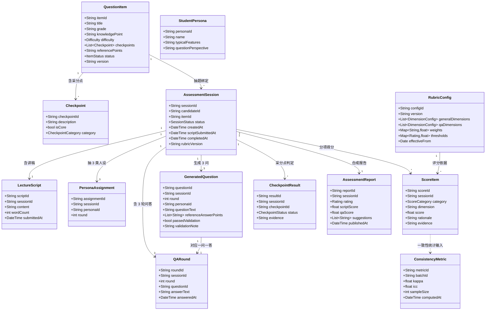
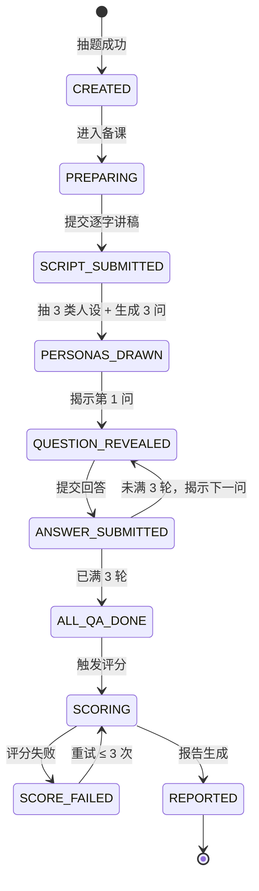

# 软件系统功能规格说明书

> 项目：教学能力评估智能体（约师）
> 版本：v2.0 ｜ 文档类型：需求阶段 — 功能需求规范
> 配套文档：[problem_definition.md](problem_definition.md) · [nonfunctional_spec.md](nonfunctional_spec.md)

---

## 0. 范围与边界

### 0.1 本系统是什么

本系统是**讲题教学能力评估智能体**：

1. 从题库抽 1 道初中数学讲题（**不提供学生人设**）；
2. 被试提交**逐字讲稿**；
3. 系统抽 3 类虚拟学生，各提 1 问（共 3 问，互不重复）；
4. 被试**依次**作答 3 轮；
5. LLM 按「通用标准 3 项 + 特殊标准（采分点）+ 问答标准 3 项」评分；
6. 输出**评级 + 分项得分 + 改进建议**。

### 0.2 本规格覆盖范围（In Scope）

| 模块 | 内容 |
|---|---|
| 题目库 | 9 个初中数学真题，含采分点与参考要点 |
| 评估会话 | 抽题 → 备课 → 提交讲稿 → 3 轮问答 |
| 虚拟学生 | 5 类人设，抽 3 类，LLM 生成问题（合理 + 不重复） |
| 评分 | 通用标准 3 项、特殊标准采分点、问答标准 3 项 |
| 报告 | 评级 + 分项得分 + 理由/证据 + 改进建议 |
| 配置 | 评分标准、示例、权重、阈值 |

### 0.3 明确排除范围（Out of Scope）

| 排除项 | 说明 |
|---|---|
| **学科知识准入测试** | 默认被试已掌握学科知识（见 `基本假设.txt`） |
| **人工复核 / 申诉** | 属下游产业环节，由使用者接入后自行完成 |
| **听觉评估** | 连贯性、口齿清晰等 → 后续扩展模块 |
| **视觉评估** | 是否读稿、板书 → 后续扩展模块 |
| **音视频采集 / 视频转录** | 第一版为纯文本输入 |
| 其他学段学科 | 仅初中数学 |
| 平台业务功能 | 订单、支付、IM、推荐算法、老师主页 |
| 实名 / 学籍认证 | 由外部系统提供 |

> **边界说明**：本系统只负责"评"。输出必须**可复核**（含逐项理由与证据），供下游自行开展人工复核。

---

## 1. 系统角色 (Actor)

| 编号 | 角色 | 类型 | 职责 |
|---|---|---|---|
| **AC-1** | **被试者**（大学生） | 人 | 抽题、备课、提交讲稿、逐轮作答、查看报告 |
| **AC-2** | **管理员** | 人 | 维护题目库与采分点、配置评分标准与示例、设定阈值 |
| **AC-3** | **提问引擎** | 系统 | 抽取学生人设、生成 3 个问题并校验合理性/去重、产出参考应答要点 |
| **AC-4** | **评分引擎** | 系统 | 按三层标准评分、合成评级、生成改进建议 |
| **AC-5** | **下游消费系统** | 系统 | 查询评估结果与评级（可自行接入人工复核） |

---

## 2. 功能树 (Feature Tree)

### FR-1 题目库管理

- **FR-1.1** 题目增删改查（题干、知识点、难度）
- **FR-1.2** 题目配套资产维护（**采分点清单**、参考讲稿要点）
- **FR-1.3** 题库导入 / 导出（CSV / JSON）
- **FR-1.4** 抽题：从 9 个真题中随机抽取 1 题
- **FR-1.5** 防泄题：记录被试已抽题目，避免短期内重复（可配置）
- **FR-1.6** 题目启停用与版本管理

### FR-2 评估会话编排

- **FR-2.1** 发起评估会话（绑定被试与题目）
- **FR-2.2** 会话状态机流转与非法流转拦截
- **FR-2.3** 讲稿提交（字数下限校验、超时控制）
- **FR-2.4** 讲稿提交后触发人设抽取与问题生成
- **FR-2.5** **逐轮揭示问题**（答完上一问才显示下一问）
- **FR-2.6** 3 轮问答编排（固定 3 轮，不可跳过）
- **FR-2.7** 中断恢复与会话超时处理
- **FR-2.8** 评估次数与冷却期控制

### FR-3 虚拟学生提问生成

- **FR-3.1** 学生人设库维护（5 类：类型、特征、提问视角）
- **FR-3.2** 从 5 类中随机抽 3 类（不重复）
- **FR-3.3** 按「题目 + 人设 + 讲稿」生成问题
- **FR-3.4** **合理性校验**（符合人设特征、与讲题相关、初中范围内可答）
- **FR-3.5** **互不重复校验**（3 问考察点不重叠）
- **FR-3.6** 生成「参考应答要点」（供评分锚定）
- **FR-3.7** 生成失败重试与降级（改用预置问题）

### FR-4 评分

- **FR-4.1** 通用标准评分（3 项 × 1~5 分 + 理由 + 证据）
- **FR-4.2** 特殊标准判定（采分点逐条：覆盖 / 部分 / 未覆盖）
- **FR-4.3** 问答标准评分（3 项 × 1~5 分 + 理由 + 证据）
- **FR-4.4** 门槛规则（采分点未满足时硬扣分/限制评级上限）
- **FR-4.5** 评级合成（优秀 / 良好 / 合格 / 待改进 / 不合格）
- **FR-4.6** 评分失败重试
- **FR-4.7** 评分版本追溯（标准版本 + 提示词版本 + 模型版本）

### FR-5 报告与建议

- **FR-5.1** 评级与分项得分展示
- **FR-5.2** 逐项理由与原文证据
- **FR-5.3** 采分点达成情况明细（含未覆盖项高亮）
- **FR-5.4** **改进建议生成**（仅当存在不足时；分讲稿/问答归类）
- **FR-5.5** 讲稿与问答存档（供下游复核回溯）
- **FR-5.6** 下游系统查询接口

### FR-6 评分标准与配置

- **FR-6.1** 通用标准 3 项的观察点与档位描述配置
- **FR-6.2** 问答标准 3 项的观察点与档位描述配置
- **FR-6.3** 权重与评级阈值配置
- **FR-6.4** 评分参照物管理（优质模板、典型问题示例）
- **FR-6.5** 版本管理与生效时间

### FR-7 数据与质量分析

- **FR-7.1** 评分数据沉淀（AI 分 + 专家分，研究验证用）
- **FR-7.2** 一致性指标计算（Kappa / ICC）
- **FR-7.3** 分项分布与区分度统计
- **FR-7.4** 操作审计日志

### FR-8 扩展预留（本期不实现）

- **FR-8.1** 评分标准分模块组织（文本 / 听觉 / 视觉），本期只启用文本
- **FR-8.2** 预留视频转录接口（视频 → 逐字讲稿）

---

## 3. 领域模型 (Domain Model UML)



---

## 4. 关键状态机：评估会话



**关键约束**：

1. `PERSONAS_DRAWN` 与问题生成**必须**在 `SCRIPT_SUBMITTED` 之后——讲稿提交前不得暴露任何学生人设与问题。
2. 问题**逐轮揭示**：第 N+1 问只在第 N 轮回答提交（`ANSWER_SUBMITTED`）后可见。
3. 固定 **3 轮**，不可跳过或提前结束。
4. 评分完成即 `REPORTED`，**无人工复核环节**。

---

## 5. 核心业务流程

```
（上游自行决定是否设置学科知识准入测试）
      ↓
① 抽题（FR-1.4）—— 只给题干，不给学生人设
      ↓
② 备课（线下，系统不计时或软计时）
      ↓
③ 提交逐字讲稿（FR-2.3）
      ↓
④ 抽 3 类人设（FR-3.2）+ 生成 3 问（FR-3.3~3.5）+ 参考要点（FR-3.6）
      ↓
⑤ 第 1 轮：揭示问题 1（FR-2.5）→ 提交回答 1（FR-2.6）
      ↓
⑥ 第 2 轮：揭示问题 2 → 提交回答 2
      ↓
⑦ 第 3 轮：揭示问题 3 → 提交回答 3
      ↓
⑧ 评分（FR-4.1~4.5）
   ├─ 通用标准 3 项
   ├─ 特殊标准（采分点逐条）
   └─ 问答标准 3 项
      ↓
⑨ 报告（FR-5.1~5.4）：评级 + 分项得分 + 建议
      ↓
（下游自行决定是否人工复核）
```

---

## 6. 关键数据规格

### 6.1 题目（QuestionItem）

| 字段 | 必填 | 说明 |
|---|---|---|
| 题号 | ✓ | 如 `M-CZ-001` |
| 题干 | ✓ | 讲题内容（如"科学计数法"） |
| 年级 / 知识点 | ✓ | 七年级 · 科学计数法 |
| 难度 | ✓ | 基础 / 中档 / 拔高 |
| **采分点清单** | ✓ | 逐条列出该题必须讲到的点，标注**是否核心** |
| 参考讲稿要点 | ✓ | 供评分参照 |
| 状态 / 版本 | ✓ | 启用 / 停用；版本号 |

### 6.2 采分点（Checkpoint）

| 字段 | 说明 |
|---|---|
| 采分点编号 | 如 `CP-6` |
| 描述 | "强调 A 的取值范围 1 ≤ A < 10" |
| **是否核心** | 核心采分点未覆盖 → 评级上限受限 |
| 类别 | 科学性 / 重点难点 / 知识点覆盖 / 易错点预判 |

### 6.3 生成问题（GeneratedQuestion）

| 字段 | 说明 |
|---|---|
| 轮次 | 1 / 2 / 3 |
| 对应人设 | 5 类之一 |
| 问题文本 | 学生提问 |
| **参考应答要点** | 一个合格回答应覆盖的点 |
| 校验结果 | 是否通过合理性与去重校验 |

### 6.4 评分项（ScoreItem）

| 字段 | 说明 |
|---|---|
| 类别 | 通用标准 / 问答标准 |
| 维度 | G1/G2/G3 或 Q1/Q2/Q3 |
| 分数 | 1~5 |
| 理由 | 为什么给这个分 |
| 证据 | 引用原文 |

---

## 7. 待补充（本规格未定，见 problem_definition 待决问题）

1. 通用 3 项、问答 3 项的 **1~5 分档位描述**
2. 通用 / 特殊 / 问答的**权重与评级合成规则**
3. **9 个真题清单**及逐题采分点
4. **优质模板 / 典型问题示例**（评分参照物）
5. 3 问**去重判定**的具体方法